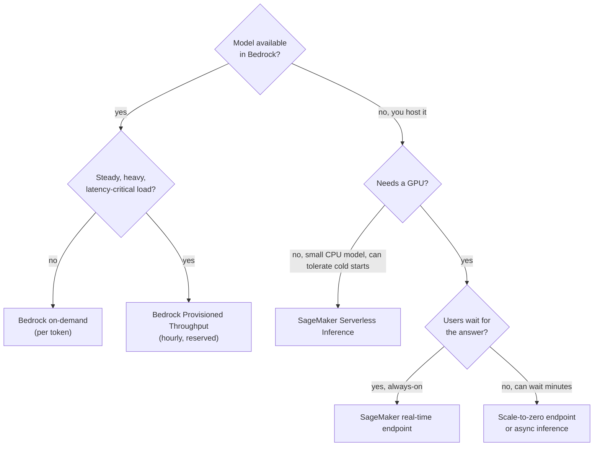

# Choosing How to Host and Call a Foundation Model

Four questions decide the hosting choice: **How steady is the traffic? Does the model need a GPU? How long can a user wait after a quiet period? How much infrastructure do you want to run?**

**Remember:** if Bedrock already offers the model, **Bedrock on-demand is the default for light or spiky traffic**: pay per token, no servers, no idle cost. Everything else is for a reason Bedrock on-demand can't meet.

## The options side by side

| Option | You pay for | Idle cost | GPU | After a quiet period | Servers to manage |
|---|---|---|---|---|---|
| **Bedrock on-demand** | Input and output tokens | None | Managed for you | Answers normally | None |
| **Bedrock Provisioned Throughput** | Hourly model units (until deleted) | Yes | Managed | Answers normally | None |
| **SageMaker real-time endpoint** | Instance hours | Yes (always on) | Yes | Answers normally | Instance sizing and scaling |
| **SageMaker Serverless Inference** | Compute used per request | None | **No** | Cold start | None |
| **SageMaker endpoint scaled to zero** (inference components) | Instance hours while running | None at zero | Yes | **Errors until an instance provisions (minutes)** | Scaling policies |
| **SageMaker Asynchronous Inference** | Instance hours while processing | None at zero | Yes | Request waits in a queue | Endpoint config |

## What to remember about each SageMaker option

- **Serverless Inference** suits intermittent traffic that tolerates cold starts. It has **no GPU support**, memory of 1–6 GB, up to 200 concurrent invocations per endpoint, and a 10 GB container limit. A real-time endpoint can't be converted into a serverless one.
- **Scale to zero** works only for endpoints hosting **inference components** (`MinInstanceCount` = 0). At zero instances the endpoint can't answer; a CloudWatch alarm on `NoCapacityInvocationFailures` triggers a step scaling policy, and **provisioning takes several minutes** during which calls return an error.
- **Asynchronous Inference** queues requests (payloads up to 1 GB, processing up to 1 hour), writes results to S3, and can scale to zero. It is for work nobody is waiting on.

## Calling the model from an application

- **Bedrock:** a Lambda function (or any code) calls `bedrock-runtime`, typically with `Converse`: [Converse and InvokeModel](../02-Amazon-Bedrock/01-Core-and-APIs/01-Converse-and-InvokeModel.md). No endpoint to create or delete.
- **SageMaker:** `InvokeEndpoint` (add `InferenceComponentName` for a component or adapter).
- A model you customized in Bedrock needs [Provisioned Throughput](../02-Amazon-Bedrock/06-Inference-Throughput-and-Routing/03-Provisioned-Throughput.md); an imported model can use on-demand ([customization](../02-Amazon-Bedrock/07-Model-Customization/01-Bedrock-Model-Customization.md)).

## Worked example

A tool calls an open-weight model a few times an hour, the model needs a GPU to answer in seconds, users wait, and Bedrock offers the same model per token.
- **Bedrock on-demand** meets everything: per-token billing, no servers, no idle cost, no cold-start wait. Delete the SageMaker endpoint to stop paying for the GPU.
- Provisioned Throughput bills hourly even when idle.
- Serverless Inference has no GPU.
- Scale to zero returns errors for minutes after idle, so users would fail.
