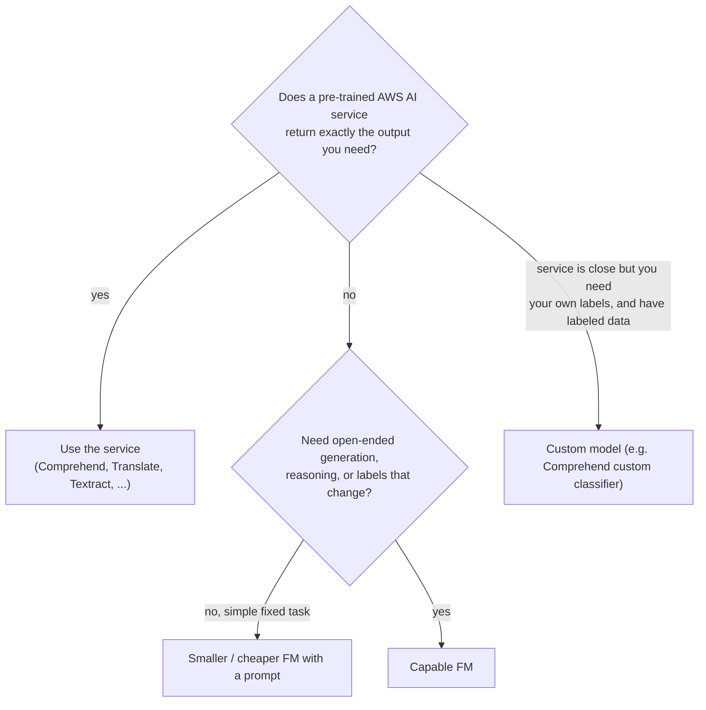

# Right-Sizing: Foundation Model vs Task-Specific Service vs Smaller Model

A large foundation model (FM) can do almost anything, but a narrow task that runs millions of times a day rarely needs that power. Paying FM prices, and maintaining a prompt for each model update, is often the wrong trade. Use the **smallest thing that meets the requirement**.

**Remember:** if an AWS AI service already returns the exact output you need, use it. It needs **no prompt, no model hosting, and no training data**, and costs far less per call.

## Pre-trained services for common narrow tasks

| Task | Service (API) |
|---|---|
| Whole-text sentiment | **Comprehend** `DetectSentiment` |
| Entities, key phrases, language, PII, toxicity | **Comprehend** |
| Translate text | **Translate** |
| Read text, forms, tables from documents | **Textract** |
| Image labels, moderation, faces | **Rekognition** |
| Speech to text / text to speech | **Transcribe** / **Polly** |
| Intent-driven chat or voice bots | **Lex** |
| Enterprise search | **Kendra** |

## Example: sentiment labels

- `DetectSentiment` returns the **overall** label (`POSITIVE`, `NEGATIVE`, `NEUTRAL`, `MIXED`) plus a **score for each**, one result per document. `BatchDetectSentiment` and async jobs handle volume.
- `DetectTargetedSentiment` gives a sentiment **per entity mention** (battery positive, screen negative), not one label for the whole review.
- A **custom classifier** is for labels the pre-trained features don't offer, and it needs **labeled training data** you have to gather; for custom models used in real time you also pay for the endpoint while it runs.
- A **smaller FM** still needs a prompt to define the task and labels, so prompt maintenance remains.

For "one label per short review, no prompt, no training data, millions per day": `DetectSentiment`.

## Cascading: cheap first, escalate when needed

Send each request to a cheap option first and escalate only the hard ones to a stronger FM. Services expose **confidence scores** that make a good escalation trigger (for example, send to an FM only when sentiment is `MIXED` or no score is above 0.8). Bedrock can automate part of this with [Intelligent Prompt Routing](../02-Amazon-Bedrock/06-Inference-Throughput-and-Routing/02-Intelligent-Prompt-Routing.md); otherwise route in your own code or Step Functions.

## When an FM is the right tool

Open-ended generation, summarization, reasoning, multi-step tasks, labels or formats that change often, or anything no pre-trained service covers. To make an FM cheaper at scale: smaller models, [distillation](Choosing-a-Customization-Approach.md), caching ([Prompt Caching](../02-Amazon-Bedrock/06-Inference-Throughput-and-Routing/01-Prompt-Caching.md)), and choosing the [right hosting option](Choosing-How-to-Host-an-FM.md).

Comprehend feature details: [Comprehend](../../14-Machine-Learning-Services/03-Comprehend/README.md).
