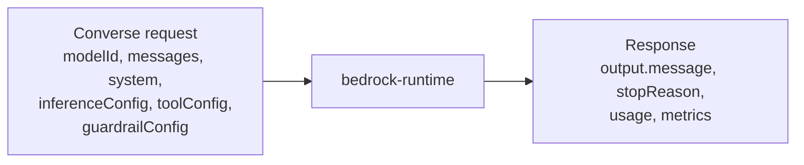

# Bedrock Runtime: Converse vs InvokeModel

Both call a model on the `bedrock-runtime` endpoint. **`InvokeModel`** sends the model's own request format. **`Converse`** is a consistent chat-style API that works across Bedrock models that support messages, so you write the code once and switch models by changing `modelId`.

**Remember:** use `Converse` / `ConverseStream` for chat, tool use, and guardrails; use `InvokeModel` when you need a model-specific body (for example embeddings).

## Converse request and response

- **`modelId`**: model ID, inference profile, provisioned model ARN, or a stored prompt ARN.
- **`messages`**: the conversation turns (`user` / `assistant`), each with content blocks.
- **`system`**: instructions for the whole conversation.
- **`inferenceConfig`**: common settings such as `maxTokens`, `temperature`, `topP`, `stopSequences`.
- **`additionalModelRequestFields`**: model-specific parameters that the common fields don't cover.
- **`toolConfig`**: tools the model may call (tool use).
- **`guardrailConfig`**: attach a guardrail: [Using Guardrails](../04-Guardrails/02-Using-Guardrails.md).
- **Response**: `output.message`, `stopReason` (for example `end_turn`, `max_tokens`, `guardrail_intervened`), `usage` (input/output/total tokens), and `metrics.latencyMs`.

`ConverseStream` returns the answer as a stream for incremental display.

## Choosing between them

- `Converse`: portable across models, built-in support for tool use and guardrails, multi-turn history passed as `messages`.
- `InvokeModel` / `InvokeModelWithResponseStream`: the body follows each model's own schema; needed for operations like generating embeddings.
- With Mistral and Meta models, Converse wraps your input in that model's prompt template for you.

Picking the right hosting option before calling: [Choosing How to Host an FM](../../01-GenAI-Fundamentals/Choosing-How-to-Host-an-FM.md). Prompt-by-ARN restrictions: [Prompt Management](../05-Prompt-Management-and-Flows/01-Prompt-Management.md).
