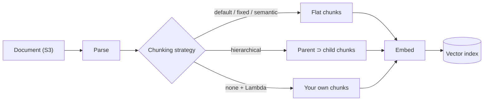
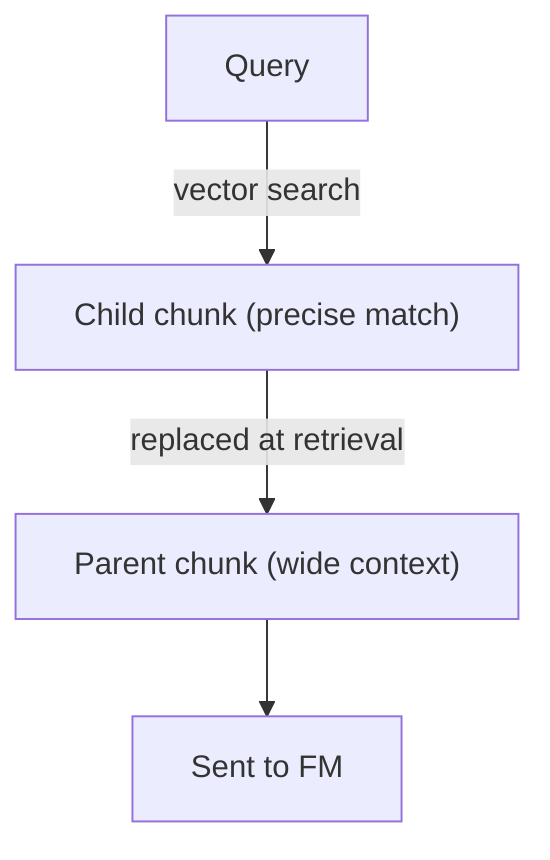
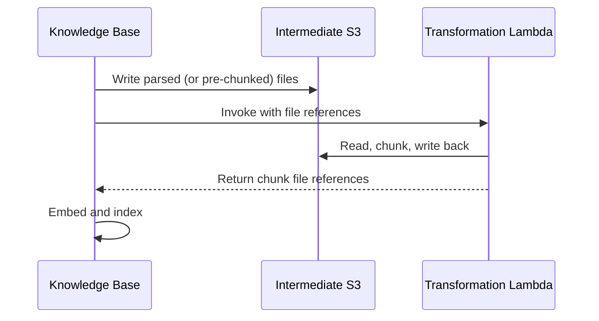
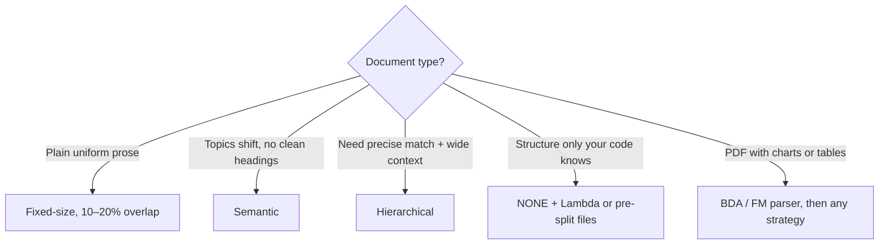

# Knowledge Bases — Chunking

Bedrock Knowledge Bases split documents into chunks at ingestion; each chunk is embedded, stored in the vector index, and is the unit returned at retrieval. Part of the [Knowledge Bases](README.md) pipeline.

> **Mental model:** chunking is cutting a book into index cards. Cards too big blow the prompt budget; cards cut mid-thought lose meaning. The strategy decides *where* the scissors go.

---

## Chunking Strategies

Set per data source (`vectorIngestionConfiguration.chunkingConfiguration.chunkingStrategy`) at creation; changing it means re-ingesting.

| Strategy | API value | Splits on | Tunables | Gotcha |
|---|---|---|---|---|
| Default | — | ~300 tokens, sentence-safe | none | Used if nothing configured |
| Fixed-size | `FIXED_SIZE` | Token count + overlap | `maxTokens` 1–8192; `overlapPercentage` 1–99 | Ignores meaning; may split related text |
| Hierarchical | `HIERARCHICAL` | Parent ⊃ child (exactly 2 levels) | 2 × `maxTokens`; `overlapTokens` ≥ 1 (absolute) | Result count can be < `numberOfResults` |
| Semantic | `SEMANTIC` | Meaning shifts between sentences | `maxTokens` 1–8192; `bufferSize` 0–1; `breakpointPercentileThreshold` 50–99 | Uses an FM at ingestion → extra cost |
| None | `NONE` | 1 file = 1 chunk | — | No page numbers in citations or page-number filter |

> [!WARNING]
> Hierarchical: not recommended with an S3 vector bucket; over ~8000 combined tokens can hit metadata size limits.

---

## How Each Strategy Cuts

### Hierarchical — search small, return big

- Search runs on **children**; the **parent** is what reaches the prompt.
- Two hits under one parent collapse into one result → fewer results than requested.
- Not summarization: parents are real text, not summaries.

### Semantic — split where meaning changes

| Parameter | Meaning | Effect of raising |
|---|---|---|
| `bufferSize` | Neighbor sentences embedded with each sentence (1 = previous + current + next) | More context, more noise |
| `breakpointPercentileThreshold` | Sentence pairs less similar than this percentile become split points | Fewer, larger chunks |
| `maxTokens` | Hard cap; oversized chunks are split further | — |

**Worked example:** 101 sentences → 100 adjacent pairs. Threshold 90 → the 10 least-similar pairs are split points → **11 chunks** (any over `maxTokens` are split again).

### Fixed-size — overlap keeps boundary context

**Worked example (generic numbers):** `maxTokens` 300, `overlapPercentage` 20 → the last ~60 tokens of each chunk repeat at the start of the next, so a sentence cut at the boundary still appears whole once.

> [!NOTE]
> For parsed content (advanced parsers, HTML) the chunker still respects page/section boundaries and does not merge across them, even if `maxTokens` would allow it.

### Multimodal

| Content | Who chunks |
|---|---|
| Text | KB text strategies above |
| Audio / video (Nova multimodal embeddings) | Embedding model; 1–30 s, default 5 s |
| Anything via Bedrock Data Automation parser | Converted to text (transcripts, scene summaries) first, then text strategies |

---

## Custom Chunking with Lambda

| Mode | Strategy setting | Lambda hook | Use for |
|---|---|---|---|
| Full custom chunking | `NONE` | Lambda does all chunking | Headings-aware splits, tables kept whole |
| Chunk-level metadata | Built-in (default / fixed-size) | `stepToApply: POST_CHUNKING` | Add per-chunk metadata after KB chunks |

| Detail | Value |
|---|---|
| Intermediate bucket | `intermediateStorage.s3Location` (required) |
| Encryption | Optional customer-managed KMS key for intermediate files |
| Lambda input | `inputFiles[].originalFileLocation`, `contentBatches[].key` |
| Lambda output | Mirrors input; batch files hold `fileContents[]` with `contentBody`, `contentType`, `contentMetadata` |
| Metadata collision | Chunk-level overwrites file-level |
| Web connector source | Arrives as markdown, not HTML |

---

## Choosing a Strategy

**Fixed-size vs Semantic vs Hierarchical:**

| | Fixed-size | Semantic | Hierarchical |
|---|---|---|---|
| Boundary based on | Token count | Meaning | Nesting |
| What is searched | Chunk | Chunk | Child |
| What is returned | Chunk | Chunk | Parent |
| Extra cost | None | FM at ingestion | None |

**Chunking vs Compression vs Truncation:**

| Approach | Controls what is sent by | Risk |
|---|---|---|
| Chunking + retrieval | Query relevance | Wrong chunking splits context |
| Prompt compression | Shortening text | Meaning distortion |
| Truncation | Cutting at limit | Uncontrolled loss — a symptom, never the design |
