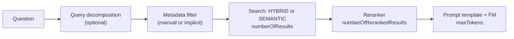

# Knowledge Bases — Query-Time Retrieval

Controls applied when querying a knowledge base with `Retrieve` or `RetrieveAndGenerate`. They decide which chunks are searched, how they are ranked, and how many reach the prompt.

---

## Controls

| Control | API field | Default | Range / values | Effect |
|---|---|---|---|---|
| Result count | `vectorSearchConfiguration.numberOfResults` | **5** | 1–100 | Max chunks retrieved; more = bigger prompt. With hierarchical chunking counts **child** chunks |
| Search type | `overrideSearchType` | Bedrock decides | `HYBRID`, `SEMANTIC` | Hybrid needs a filterable text field, else semantic. How it works: [Hybrid Search](../../05-Vector-Stores-and-Embeddings/02-Hybrid-Search.md) |
| Reranker | `rerankingConfiguration` | off | `BEDROCK_RERANKING_MODEL` | Re-scores results; overrides default ranking. See [Reranking](04-Reranking.md) |
| Reranked count | `numberOfRerankedResults` | n/a | 1–100 | Results kept after reranking |
| Metadata filter | `filter` | none | operators below | Restricts candidates by attribute |
| Implicit filter | `implicitFilterConfiguration` | off | `metadataAttributes[]`, `modelArn` | An Anthropic Claude model builds the filter from the question |
| Query decomposition | `orchestrationConfiguration.queryTransformationConfiguration.type` | off | `QUERY_DECOMPOSITION` | Splits a multi-part question into sub-queries |
| Generation cap | `inferenceConfig.textInferenceConfig.maxTokens` | model default | model range | Too low truncates the **answer** |
| Streaming | `RetrieveAndGenerateStream` | n/a | n/a | Streams the generated answer |

| API | Returns | Use when |
|---|---|---|
| `Retrieve` | Chunks only | You build the prompt; full token-budget control |
| `RetrieveAndGenerate` | Retrieved chunks + generated answer | Managed RAG in one call |

> [!NOTE]
> Query configurations other than orchestration/generation apply to **unstructured** data sources only.

---

## Metadata Filtering

| Operator | API | Types |
|---|---|---|
| equals / notEquals | `equals`, `notEquals` | string, number, boolean |
| Comparison | `greaterThan`, `greaterThanOrEquals`, `lessThan`, `lessThanOrEquals` | number |
| In / not in | `in`, `notIn` | string list (best with OpenSearch Serverless, Neptune Analytics) |
| Contains | `stringContains`, `listContains` | string / string list (best with OpenSearch Serverless) |
| Starts with | `startsWith` | OpenSearch Serverless only; **not** S3 Vectors |
| Combine | `andAll`, `orAll` | up to **5** filters per group; one nesting level |

| Requirement | Detail |
|---|---|
| S3 data source | Each file needs a `<file>.<ext>.metadata.json` |
| OpenSearch Serverless | Index engine must be **faiss** (nmslib breaks filtering) |
| Aurora | Use one JSONB `custom_metadata` column + GIN index |
| PDF page numbers | `x-amz-bedrock-kb-document-page-number` (OpenSearch Serverless / Aurora); not with no-chunking |
| Reserved metadata | `x-amz-bedrock*` prefix reserved; cannot override |

---

## Troubleshooting

| Symptom | Likely cause | Fix |
|---|---|---|
| Fewer results than `numberOfResults` | Hierarchical parent merge, or filter too tight | Expected; widen filters |
| Filter returns nothing on OpenSearch | Index uses `nmslib` or text-typed field | Use faiss; keyword-typed metadata |
| Answer cut off | `maxTokens` too low | Raise cap |

---

## Need → Pick

| Need | Pick |
|---|---|
| Multi-part question | Query decomposition |
| Filter chosen from the question text | Implicit filtering (Claude) |
| Control the full prompt yourself | `Retrieve`, then your own prompt |
