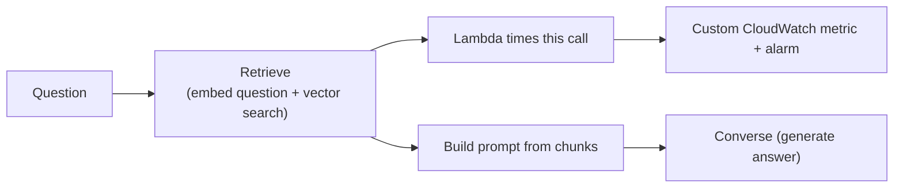

# Measuring Retrieval Latency in a Knowledge Base

**Problem:** answers got slower after the document set grew. How much of the wait is *finding the chunks*, and can we alarm on it?

**Remember:** `RetrieveAndGenerate` does retrieve + generate in **one call** and reports only the total. To time retrieval alone, call **`Retrieve`**, time it, then call **`Converse`** yourself.

## How to do it

1. In the function, record the time before and after the `Retrieve` call.
2. Publish it with `PutMetricData` (for example `RetrievalLatencyMs`, dimension = knowledge base ID). Mechanics: [CloudWatch custom metrics](../../10-Observability-and-Cost-Optimization/01-CloudWatch-Custom-Metrics-and-Alarms.md).
3. Optionally time `Converse` and the total too, so you can see which part grows.
4. Alarm on the retrieval metric (average or a percentile, with "M out of N" evaluation).

Trade-off: with `Retrieve` + `Converse` you build the prompt yourself (full control, more code). More on the two APIs: [Query-Time Retrieval](03-Query-Time-Retrieval.md).

## Why the other measures don't work

| Measure | What it actually shows | Why it fails here |
|---|---|---|
| Time the whole `RetrieveAndGenerate` call | Retrieval **and** generation together | Can't split the two |
| OpenSearch Serverless `SearchRequestLatency` | Average search time for the **whole collection** (dimensions: client, collection; **no index dimension**) | Mixes the other teams' searches; also excludes embedding the question |
| Knowledge base logging (`APPLICATION_LOGS`) | **Ingestion** only: status of each file during a sync (embedding, indexing, failures) | Says nothing about query-time searches |

> [!NOTE]
> Retrieval time = embedding the question + searching the vector index (+ reranking if enabled). A collection-level metric can only see the search part, and only averaged across everyone sharing the collection.
