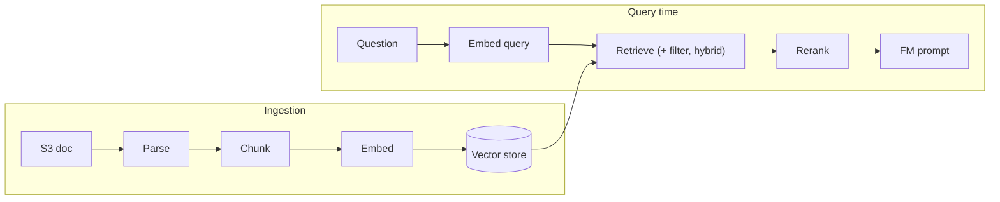

# Amazon Bedrock Knowledge Bases

Fully managed RAG: ingests documents from a data source, parses, chunks, embeds, stores vectors, and serves retrieval (`Retrieve`) or retrieval plus generation (`RetrieveAndGenerate`).

**Key Concepts:**
- **Chunk**: the unit that is embedded, stored, and returned at retrieval; keeps a mapping back to the source document.
- **Retrieve-then-generate**: embed chunks once, embed the query at runtime, fetch top-k similar chunks, pass only those; prompt size depends on the query, not the document size.

| File | Content |
|---|---|
| `01-Chunking.md` | Default/fixed/hierarchical/semantic/none, custom Lambda chunking, strategy selection |
| `02-Parsing.md` | Default parser vs Bedrock Data Automation vs FM parser |
| `03-Query-Time-Retrieval.md` | `numberOfResults`, hybrid search, metadata filters, query decomposition, generation cap |
| `04-Reranking.md` | Reranker models, `Rerank` API, KB-integrated reranking, permissions |

Vector stores and search internals live in [05-Vector-Stores-and-Embeddings](../../05-Vector-Stores-and-Embeddings/README.md).

**Pending:** ingestion/sync jobs, `Retrieve` vs `RetrieveAndGenerate` internals, service role and encryption.
