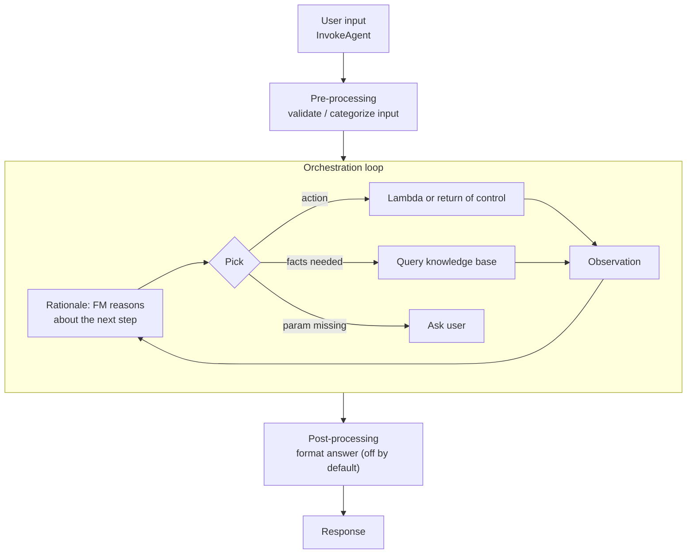

# Bedrock Agents

A **Bedrock Agent** lets a foundation model (FM) plan a task, call your APIs (**actions**), query **knowledge bases**, and loop until it can answer. You describe *what* it can do; the FM decides *which step next*.

> [!NOTE]
> **Status:** Agents is now **Agents Classic**: no new sign-ups, existing users continue (maintenance mode). AWS points new builds to code-defined agents (Strands) on [AgentCore](02-AgentCore.md). The concepts below still apply.

## Build-time parts

- **Foundation model + instructions**: the model that reasons, and plain-language text saying what the agent is for.
- **Action group**: a set of actions the agent may perform (for example `BookHotel` with `CreateBooking`, `GetBooking`, `CancelBooking`). Two ways to declare parameters:
  - **OpenAPI schema**: API paths and parameters (schema from S3 or inline).
  - **Function details**: just names and parameters, no schema file.
- **Executor**: who runs the action: a **Lambda function** (gets the action + parameters, returns the result) or **return of control** (below).
- **Knowledge base**: attach one or more; the agent queries it when it needs facts ([Knowledge Bases](../02-Knowledge-Bases/README.md)).
- **Prompt templates**: four editable base prompts (pre-processing, orchestration, KB response generation, post-processing). *Advanced prompts* let you add few-shot examples, change parsing with a Lambda, or turn steps off.
- **Guardrail**: optional, applied to input and output ([Guardrails](../04-Guardrails/README.md)).
- If the agent lacks a required parameter it **asks the user** instead of guessing.

You must **prepare** the agent (`PrepareAgent`) before it can be tested.

## Runtime: what `InvokeAgent` does

It is a **ReAct-style loop**: rationale → action → observation → repeat, until the agent can answer or must ask the user. Conversation history within a session is kept and added to each prompt.

## Return of control

Set the executor to `RETURN_CONTROL` and the agent does **not** call Lambda. Instead `InvokeAgent` returns `invocationInputs` (action group, function or API path, parameters) plus a unique `invocationId`. Your **application** runs the action, then calls `InvokeAgent` again with `sessionState.returnControlInvocationResults` and the **same `invocationId`** (`inputText` is ignored).

Use it when the action must run **in your app** (client-side, user's own credentials, a long-running job, a system Lambda can't reach) or when you want the app to **confirm** before anything executes.

## Memory and sessions

| Thing | Behavior |
|---|---|
| Default | Context kept for **one session** (`sessionId`) |
| **Memory** (enable per agent) | **Summaries** of past sessions saved under a `memoryId` (use one per user) and loaded into new sessions |
| Retention | 1 to **365 days** |
| Session ends | `endSession=true` or `idleSessionTimeout` passes; summarization then runs asynchronously |
| `sessionAttributes` | Persist across the whole session |
| `promptSessionAttributes` | Apply to **one turn** only |

## Trace

Pass `enableTrace=true` to see every **rationale, action input, observation, KB query, and the full prompt/output** per step. This is the debugging tool and the source of "why did the agent do that" transparency.

## Multi-agent collaboration

One **supervisor agent** plans and delegates to **collaborator agents**, each a full agent (own tools, KBs, guardrails) with a clear, non-overlapping role.

- **Supervisor**: breaks the task down, calls collaborators (can run in parallel), merges answers.
- **Supervisor with routing**: simple requests are **routed straight** to the right collaborator, complex ones go through full planning.
- Save the supervisor first, then attach collaborators. Collaborators can also return control to the caller.

## Deploying: versions and aliases

`DRAFT` is the working copy. A **version** is an immutable snapshot of it. An **alias** points to a version, and callers use the alias ID in `InvokeAgent`. **Roll back** by repointing the alias; the test alias is `TSTALIASID` (points to DRAFT).

## Lambda permission

The Lambda needs a **resource-based policy** allowing `bedrock.amazonaws.com` to invoke it (restrict with `aws:SourceArn` to the agent). The agent's **service role** needs `bedrock:InvokeModel` for its FM and access to its KBs.

**Agents vs Flows vs Step Functions:** Agents = the **model decides** the steps at runtime. [Flows](../05-Prompt-Management-and-Flows/README.md) and Step Functions = **you define** the steps; use them when the path is known and must be predictable and auditable.
