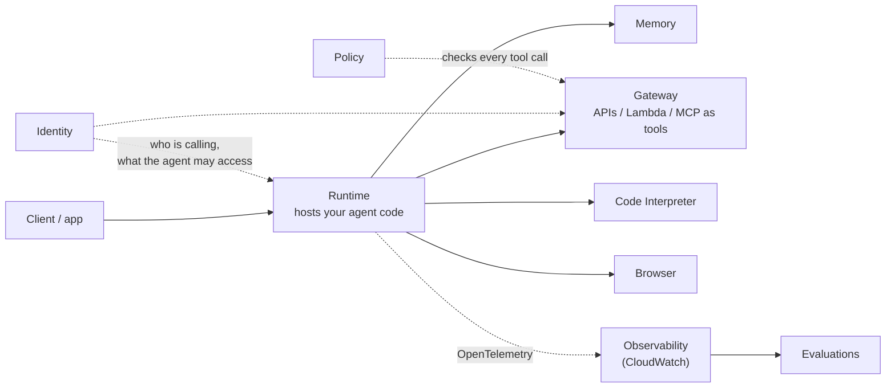

# Amazon Bedrock AgentCore

**AgentCore** is a set of modular services for **running agents in production**: hosting, memory, tool access, identity, monitoring. It works with **any framework** (Strands, LangGraph, CrewAI, LlamaIndex, OpenAI Agents SDK) and **any model** (in or outside Bedrock), and you can adopt one service without the rest. Pay-per-use, no infrastructure to manage.

**Remember:** Bedrock Agents *is* the agent (managed loop, fixed shape). AgentCore *runs and secures* an agent **you wrote in code**.

## The services

| Service | What it does |
|---|---|
| **Runtime** | Serverless host for agents **and tools**. Fast cold starts, **each session in its own isolated environment**, long-running and async work, MCP and **A2A** (agent-to-agent) protocols, multimodal |
| **Memory** | **Short-term** (turns within a session) and **long-term** (persists across sessions; can be shared between agents and learn from experience) |
| **Gateway** | Turns **APIs, Lambda functions, OpenAPI specs and existing services into MCP tools**, and fronts existing MCP servers. Agents discover tools through one endpoint |
| **Identity** | Agent identity, access and credential management. Works with existing IdPs (Cognito, Okta, Entra ID, Auth0); no user migration |
| **Code Interpreter** | Isolated **sandbox** to run agent-written code (Python, JavaScript, TypeScript) |
| **Browser** | Managed cloud browser so agents can navigate sites and fill forms (Playwright, BrowserUse) |
| **Observability** | Traces, step-by-step visualization and debugging; emits **OpenTelemetry**, shows in CloudWatch or any OTEL-compatible stack |
| **Evaluations** | Automated quality scoring of agent sessions, traces and spans, before and after deployment |
| **Policy** | **Deterministic** rules (natural language or Cedar-compatible) enforced on every tool call at the Gateway: which tools, what actions, under what conditions |
| **Registry** | Catalog to discover and govern agents, MCP servers and tools across the organization |

Also in the docs: **Harness** (a managed agent loop defined with one API call), **Optimization** (A/B testing of prompts and tool descriptions), **Payments** (agents paying for APIs). These are newer; check current docs.

## When AgentCore, when Bedrock Agents

| | Bedrock Agents (Classic) | AgentCore |
|---|---|---|
| You write | Instructions + action groups (config) | Agent code in any framework |
| Loop | Managed, fixed (ReAct with prompt templates) | Yours |
| Models | Bedrock models | Any model |
| Pick when | Simple managed agent, no code (existing users only) | Custom logic, open-source framework, strict isolation, long jobs, tool governance |

