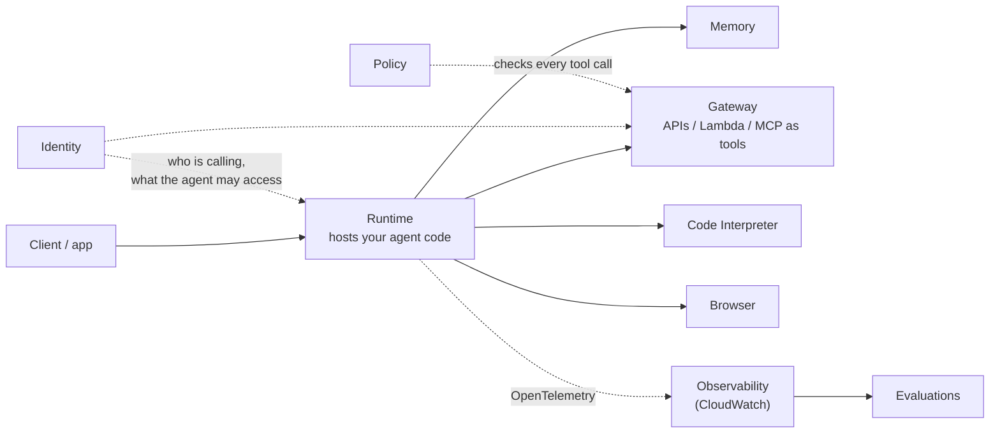

# Amazon Bedrock AgentCore

**AgentCore** is a set of modular services for **running agents in production**: hosting, memory, tool access, identity, monitoring. It works with **any framework** (Strands, LangGraph, CrewAI, LlamaIndex, OpenAI Agents SDK) and **any model** (in or outside Bedrock), and you can adopt one service without the rest. Pay-per-use, no infrastructure to manage.

**Remember:** Bedrock Agents *is* the agent (managed loop, fixed shape). AgentCore *runs and secures* an agent **you wrote in code**.

## The services

| Service | What it does |
|---|---|
| **Runtime** | Serverless host for agents **and tools**. Fast cold starts, **each session in its own isolated environment**, long-running and async work, MCP and **A2A** (agent-to-agent) protocols, multimodal |
| **Memory** | **Short-term** (turns within a session) and **long-term** (persists across sessions; can be shared between agents and learn from experience) |
| **Gateway** | Turns **APIs, Lambda functions, OpenAPI specs and existing services into MCP tools**, and fronts existing MCP servers. Agents discover tools through one endpoint |
| **Identity** | Agent identity, access and credential management. Works with existing IdPs (Cognito, Okta, Entra ID, Auth0); no user migration |
| **Code Interpreter** | Isolated **sandbox** to run agent-written code (Python, JavaScript, TypeScript) |
| **Browser** | Managed cloud browser so agents can navigate sites and fill forms (Playwright, BrowserUse) |
| **Observability** | Traces, step-by-step visualization and debugging; emits **OpenTelemetry**, shows in CloudWatch or any OTEL-compatible stack |
| **Evaluations** | Automated quality scoring of agent sessions, traces and spans, before and after deployment |
| **Policy** | **Deterministic** rules (natural language or Cedar-compatible) enforced on every tool call at the Gateway: which tools, what actions, under what conditions |
| **Registry** | Catalog to discover and govern agents, MCP servers and tools across the organization |

Also in the docs: **Harness** (a managed agent loop defined with one API call), **Optimization** (A/B testing of prompts and tool descriptions), **Payments** (agents paying for APIs). These are newer; check current docs.

## Runtime protocols (the service contract)

Your agent is a **container** that must speak one of four protocols; the protocol decides the port, the path, and what the caller sees. All run on **host `0.0.0.0`**, **ARM64**, and the caller reaches them through `InvokeAgentRuntime`.

| | **HTTP** | **MCP** | **A2A** | **AG-UI** |
|---|---|---|---|---|
| For | Direct agent calls, streaming | **Tool servers** | **Agent-to-agent** collaboration | Interactive UI experiences |
| Default port | **8080** | **8000** | **9000** | 8080 |
| Main endpoint | `POST /invocations`; `/ws` WebSocket | `POST /mcp` | `POST /` (root) | `/invocations` (SSE), `/ws` |
| Message format | JSON or **SSE** stream; WebSocket text/binary | JSON-RPC | **JSON-RPC 2.0** | Event streams (SSE / WebSocket) |
| Discovery | none | tool listing | **Agent Card** at `GET /.well-known/agent-card.json` | none |
| Health | `GET /ping` | `GET /ping` (recommended) | `GET /ping` | |
| Auth | SigV4 or OAuth 2.0 | SigV4 or OAuth 2.0 | SigV4 or OAuth 2.0 | SigV4 or OAuth 2.0 |

- **HTTP**: `/invocations` takes JSON (`{"prompt": ...}`) and answers with JSON, or `text/event-stream` for **streaming**. `/ws` (optional, same container and port) gives **bidirectional real-time** messages; the path is always `/ws`. A WebSocket session is bound with the `X-Amzn-Bedrock-AgentCore-Runtime-Session-Id` header.
- **MCP**: uses the **Streamable HTTP** transport, **stateless** by default (state lives in your own store, referenced by IDs); stateful mode is also supported, and is **required** for elicitation and sampling on MCP versions up to 2025-11-25. The platform forwards session headers (`Mcp-Session-Id`, `X-Amzn-Bedrock-AgentCore-Runtime-Session-Id`), so the server must not reject them. Don't confuse with [Gateway](#the-services), which *converts* APIs into MCP tools; here **you host** the MCP server.
- **A2A**: the Agent Card advertises name, skills, version and URL so other agents can find and call it.
- **Configurable**: the serving port and POST path can be changed with `protocolConfiguration` (the `/ws` path can't); some ports are reserved for the platform (for example 8443, 2049, 4317 to 4318).

**`/ping` and sessions.** The reply is JSON `{"status": "Healthy"}` or `{"status": "HealthyBusy"}`. `HealthyBusy` means "still working in the background", so the session is treated as **active** and not ended for idleness. Gotcha: don't set `time_of_last_update` to "now" on every ping; only on a real change, or the idle timeout never fires and sessions live to `MaxLifetime` and eat your session quota (the AgentCore SDK handles this). For MCP, `/ping` is optional; without it the platform probes with an MCP `ping` request.

**Errors**: HTTP returns native status codes with an `x-amzn-ErrorType` header; MCP and A2A wrap errors in JSON-RPC error bodies (and A2A returns the real HTTP status too). Unauthenticated OAuth agents get `401` plus a `WWW-Authenticate` header; SigV4 agents get `403`.

---

## When AgentCore, when Bedrock Agents

| | Bedrock Agents (Classic) | AgentCore |
|---|---|---|
| You write | Instructions + action groups (config) | Agent code in any framework |
| Loop | Managed, fixed (ReAct with prompt templates) | Yours |
| Models | Bedrock models | Any model |
| Pick when | Simple managed agent, no code (existing users only) | Custom logic, open-source framework, strict isolation, long jobs, tool governance |

