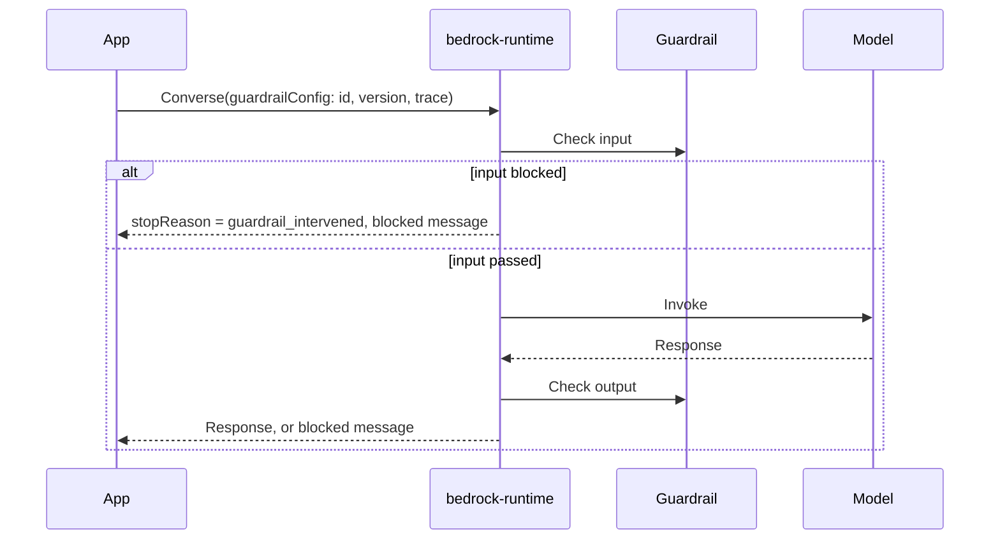

# Using Guardrails at Inference Time

A guardrail does nothing until it is attached to a request. There are two ways to use one: **attach it to a model call** so it checks automatically, or **call it on its own** with `ApplyGuardrail` to check any text, with or without a model.

---

## Attached to a model call

You pass the guardrail's ID and version in the request. Bedrock then checks the input before the model sees it and the output before you see it, with no extra orchestration of your own.



`guardrailConfig` carries `guardrailIdentifier`, `guardrailVersion`, and `trace` (`enabled` to get the assessment). `InvokeModel` takes the same information in the request. For `ConverseStream`, `streamProcessingMode` controls streaming (below).

### Choosing what gets checked

By default the guardrail checks the user and assistant messages but **not the system prompt**. You narrow or extend that with `guardContent`:

- Wrap text in `guardContent` to mark it for checking. This is how you tell the guardrail which part is genuine user input (important for prompt-attack detection).
- **Once you use `guardContent` anywhere in the messages, only the `guardContent` blocks are evaluated.** Everything else in the messages is skipped for most policies. Use it to check only the latest user message, or to add instructions the guardrail should ignore.
- To check the system prompt, put `guardContent` inside it; otherwise it is not assessed.

For `InvokeModel`, which has no structured `guardContent`, you mark user input with **input tags**: `<amazon-bedrock-guardrails-guardContent_xyz> ... </amazon-bedrock-guardrails-guardContent_xyz>`, with the suffix `xyz` declared in the request's `amazon-bedrock-guardrailConfig` as `tagSuffix`.

> [!WARNING]
> On `InvokeModel` / `InvokeModelWithResponseStream`, prompt attacks are **not filtered unless user input is tagged**. A developer system prompt can look like an attack, so untagged text is left alone.

Tool use is only partly covered: tool results, tool definitions, and the arguments the model generates for a tool are **not** evaluated by content, topic, word, sensitive-information, or prompt-attack policies.

For guardrails on a stored prompt (`modelId` = prompt ARN) see the restrictions in [Prompt Management](../05-Prompt-Management-and-Flows/01-Prompt-Management.md).

### Streaming

With `ConverseStream`, `streamProcessingMode` chooses between **synchronous** (the guardrail assesses each piece before it is returned, safer but adds latency) and **asynchronous** (the model streams immediately while the guardrail assesses in the background, faster but a violation may be detected after text has already reached the user). Contextual grounding has the same issue: a bad answer can be flagged only after streaming ends.

---

## Reading the result

When the guardrail steps in, the response has `stopReason: guardrail_intervened`, and the output text is your configured blocked message. With `trace` enabled, the assessment lists which policy fired and the `action` taken.

**Blocked vs masked look the same in `stopReason`.** A sensitive-information filter set to mask returns a usable response with placeholders like `{NAME}` but still reports `guardrail_intervened`. To tell them apart, read the trace: `action` is `BLOCKED` or `ANONYMIZED`.

> [!WARNING]
> The trace includes the original matched text and the pre-masking model output. Treat it as sensitive and don't log it next to ordinary responses.

---

## ApplyGuardrail: standalone checks

`ApplyGuardrail` evaluates text against a guardrail **without invoking any model**. Use it when:
- the model isn't a Bedrock model (a third-party or self-hosted model),
- you want to check at a specific point in a pipeline, such as validating the user's question **before** retrieval in a RAG app instead of waiting for the final answer,
- you want to check content that never goes to a model.

```
POST /guardrail/{guardrailIdentifier}/version/{guardrailVersion}/apply
{ "source": "INPUT" | "OUTPUT",
  "content": [ { "text": { "text": "How should I invest for my retirement?" } } ] }
```

`source` says which side of the conversation the text is, which decides whether input or output settings apply. The response:
- `action`: `GUARDRAIL_INTERVENED` or `NONE`.
- `outputs`: if blocked, a single text holding your blocked message; if only masked, your content returned with masking applied; if nothing happened, an empty array.
- `assessments`: what each policy found. By default only detections are listed; set `outputScope` to `FULL` to also see non-detected entries for debugging. (Full scope doesn't cover word filters or regex.)
- `usage`: processing units per policy, useful for cost tracking.

**Worked example:** a guardrail with a denied topic "Fiduciary Advice" receives `INPUT` text "How should I invest for my retirement? I want $5,000 a month". The response is `GUARDRAIL_INTERVENED`, `outputs` holds the blocked message, and `assessments.topicPolicy` names the topic with action `BLOCKED`.

**Permissions:** calling `ApplyGuardrail` alone needs only `bedrock:ApplyGuardrail` on the guardrail ARN. The `InvokeModel` permissions are needed only when you also call Bedrock models.

---

## Telling the guardrail what each block is (grounding qualifiers)

Contextual grounding needs the source, the query, and the response identified. In Converse and `ApplyGuardrail`, a content block's `qualifiers` say what it is, and also decide whether other policies check it:

| Qualifier | Role for grounding | Checked by other policies? |
|---|---|---|
| `grounding_source` | Reference source | No |
| `query` | The user's question | No |
| `guard_content` or none | The content to guard (the response) | Yes |
| `["grounding_source", "guard_content"]` | Reference source | Yes |

With `ApplyGuardrail` there is no model, so you also supply the response text as an extra block. On the `Invoke` APIs use tags `amazon-bedrock-guardrails-groundingSource_xyz` and `amazon-bedrock-guardrails-query_xyz`. Grounding is only evaluated on output.

---

## Troubleshooting

- **Guardrail seems to ignore user input**: another `guardContent` block exists, so unmarked text is skipped; wrap the user text too.
- **Jailbreak not caught on `InvokeModel`**: user input wasn't tagged.
- **Can't tell if a response was masked or blocked**: read the trace `action`, not `stopReason`.
- **Streaming shows disallowed text**: async mode; switch to synchronous.
- **Grounding check never fires**: source or query not qualified, or no response content to guard.
