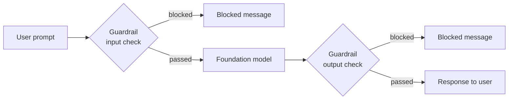

# Amazon Bedrock Guardrails

Guardrails is a managed safety layer that checks what goes **into** a model and what comes **out** of it, against policies you define once and reuse everywhere. It can block harmful language, refuse whole subject areas, remove personal data, catch jailbreak attempts, and flag answers that aren't backed by your source documents.

It exists because prompting alone ("please don't give investment advice") is not enforceable: a model can be talked out of it. A guardrail sits outside the model, so the rules hold regardless of what the prompt says, and one guardrail can protect many models and applications with a single place to change policy.

A **guardrail** is a bundle of policies (content filters, denied topics, word filters, sensitive-information filters, contextual grounding, and so on) plus the messages shown when something is blocked. At least one policy and the blocked messaging are required. Each policy can be set separately for the input side and the output side, and each can **block**, **mask** (PII only), or just **detect** so you can test safely.

| File | What it covers |
|---|---|
| `01-Policy-Types.md` | What each policy does, how to choose between them, limits |
| `02-Using-Guardrails.md` | Attaching to `InvokeModel`/`Converse`, `guardContent` and tags, streaming, the standalone `ApplyGuardrail` API, reading results |
| `03-Tiers-Versions-Governance.md` | Classic vs Standard tiers, versions, IAM enforcement, permissions, logging gotchas |

Where else guardrails show up: on a prompt by ARN ([Prompt Management](../05-Prompt-Management-and-Flows/01-Prompt-Management.md)) and per node in a flow ([Flow Nodes](../05-Prompt-Management-and-Flows/03-Flow-Nodes.md)).

**Pending:** guardrails with Agents and Knowledge Bases `RetrieveAndGenerate`, image content filters in depth, Automated Reasoning policy authoring, custom moderation workflows (Step Functions/Lambda) and defense-in-depth with Comprehend.
