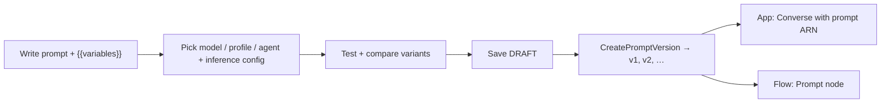
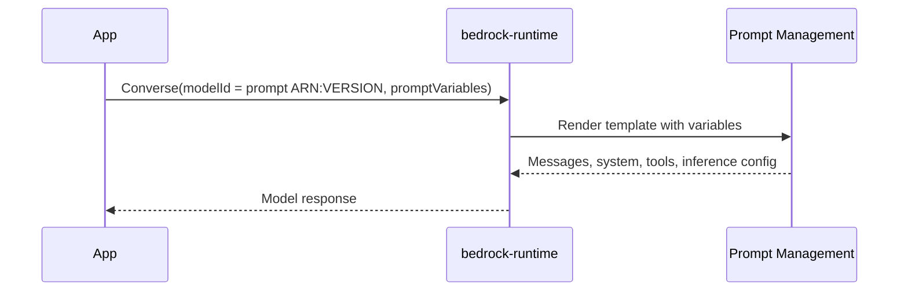

# Bedrock Prompt Management

Create, version, and reuse prompts as managed resources, with variables, model and inference settings, and side-by-side variants. Applications call a prompt by ARN instead of embedding prompt text in code.

> **Mental model:** a prompt becomes a *deployable artifact* like a Lambda function: edit the `DRAFT`, snapshot a numbered immutable version, point production at that version.



**Key Concepts:**
- **Prompt**: managed resource holding variants; first save creates a `DRAFT`.
- **Variable**: `{{name}}` placeholder filled at test or invoke time.
- **Variant**: alternative message, model, or inference config of the same prompt.
- **Version**: immutable snapshot of the draft, numbered from 1 (`CreatePromptVersion`).
- **Prompt builder**: console UI to write, test, and compare.

---

## Prompt Contents

| Setting | Detail |
|---|---|
| Template type | `TEXT` (single prompt) or `CHAT` (system + message history + tools) |
| `CHAT` requirement | Models supporting Converse API; **needed for prompt caching** |
| Variables | Double curly braces: `{{customer_name}}` |
| Model target | `modelId` (FM or inference profile ARN/ID) **or** `genAiResource` (an agent) |
| Base inference params | `maxTokens`, `stopSequences`, `temperature`, `topP` |
| Model-specific params | `additionalModelRequestFields` JSON (e.g. `top_k`); does not override base values set in console |
| Optional (Converse-capable models) | System prompt, prior user/assistant turns, tools, reasoning tokens |
| Prompt caching option | None / Tools / Tools+system / Tools+system+messages (per model) |
| Variant metadata | Key-value `metadata` array per variant |
| Encryption | AWS managed key by default; optional customer managed KMS key |
| API required fields | `name`, `variants`, `defaultVariant` |

> [!NOTE]
> A prompt tied to an **agent** (`genAiResource`) can only be tested in the console. Via API, send the prompt text in `InvokeAgent` `inputText`.

---

## Variants and Versions

| | Variants | Versions |
|---|---|---|
| Purpose | Compare alternatives while iterating | Freeze a release |
| Mutable | Yes (part of the draft) | **No, immutable** |
| Limit | Up to **3** compared at once (console) | Numbered 1, 2, 3… |
| Result | **Save as draft** keeps one, deletes the others | Production points at a version |

```
DRAFT (editable) ──CreatePromptVersion──▶ v1 (frozen)
      │  edit, retest                          
      └──CreatePromptVersion──▶ v2 (frozen)     app switches by changing the version in the ARN
```

- Test values for variables are temporary; they are not saved with the prompt.
- A change to production = new version + app/flow points to it. Rollback = point back to the old version.

---

## Running a Prompt



Prompt ARN format as `modelId`: `arn:aws:bedrock:<region>:<acct>:prompt/<PROMPT_ID>:<VERSION>`

`promptVariables` shape: `{"variable_name": {"text": "value"}}`

| Calling | Works with a prompt ARN |
|---|---|
| `Converse`, `ConverseStream` | Yes |
| `InvokeModel`, `InvokeModelWithResponseStream` | Yes |
| Flow **Prompt node** | Yes (`promptArn`) |
| Agent | Console test, or paste text into `InvokeAgent` |

**Converse restrictions when `modelId` is a prompt:**

| Field | Allowed? | Behavior |
|---|---|---|
| `system`, `inferenceConfig`, `toolConfig`, `additionalModelRequestFields` | **No** | Defined by the prompt |
| `messages` | Yes | **Appended after** the prompt's messages |
| `guardrailConfig` | Yes | Applies to the **entire** prompt |
| `guardContent` blocks | Yes | Guardrail applies **only** to those blocks |

> [!WARNING]
> Override attempts for `system`/`inferenceConfig`/`toolConfig` are rejected, not ignored. Change the prompt (new version) instead.

---

## Endpoints and Operations

| Need | API | Endpoint |
|---|---|---|
| Create/update/version prompts | `CreatePrompt`, `UpdatePrompt`, `CreatePromptVersion` | `bedrock-agent` (build-time) |
| Run prompt | `Converse`, `InvokeModel` | `bedrock-runtime` |
| Optimize prompt text | `OptimizePrompt` | `bedrock-agent-runtime` |
| Flow using the prompt | `InvokeFlow` | `bedrock-agent-runtime` |

---

## Prompt Optimization

Heuristic one-shot rewrite of a single prompt for a chosen target model.

| Aspect | Detail |
|---|---|
| API | `OptimizePrompt(input.textPrompt.text, targetModelId)` |
| Response stream | `analyzePromptEvent`, then `optimizedPromptEvent` |
| Best for | Prompts of about **1k tokens or less**, English |
| Not | Evaluation-driven; single model only (evaluation-driven is "Advanced Prompt Optimization") |
| Console | Wand icon in playground; **Optimize** in prompt builder (shows as a variant) |

---

## Governance Pattern

Prompt Management has versioning and KMS encryption natively. Approval workflows are something you build around it.

| Control | How |
|---|---|
| Immutable releases | Numbered versions |
| Least privilege | IAM on `prompt/<id>` resources; flows service role needs `bedrock:RenderPrompt` |
| Approval before prod | Pipeline gate (e.g. Step Functions / CodePipeline manual approval) before app config points to a new version |
| Audit | CloudTrail records control-plane calls such as `CreatePromptVersion` |
| Template backup / review | Keep template source in S3 or Git (project pattern, not a built-in feature) |

> [!NOTE]
> The exam-guide phrasing "approval workflows" maps to this build-it-yourself pattern. The docs describe no built-in approval step.

---

## Need → Pick

| Need | Pick |
|---|---|
| Same prompt reused by many apps | Prompt Management + prompt ARN in `Converse` |
| Safe prompt release and rollback | Immutable version; repoint consumer |
| Compare wording or models | Variants (up to 3) in prompt builder |
| Multi-step prompt chain | Prompt node in [Prompt Flows](02-Prompt-Flows.md) |
| Reduce cost of a long static prefix | `CHAT` template + prompt caching ([details](../06-Inference-Throughput-and-Routing/01-Prompt-Caching.md)) |
| Enforce safety on input and output | Guardrail via `guardrailConfig` on the call, or on the flow Prompt node |
| Quick rewrite for a target model | `OptimizePrompt` |

**Prompt Management vs Prompt Flows:**

| | Prompt Management | Prompt Flows |
|---|---|---|
| What it manages | One prompt (+ variants, versions) | A multi-node workflow |
| Runs | Via `Converse` / `InvokeModel` with prompt ARN | Via `InvokeFlow` on an alias |
| Versioning | Prompt versions | Flow versions + aliases |
| Relationship | Reusable building block | Consumes prompts through Prompt nodes |
