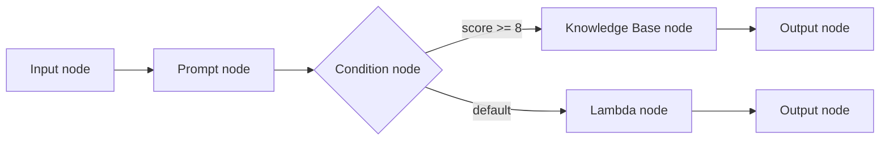
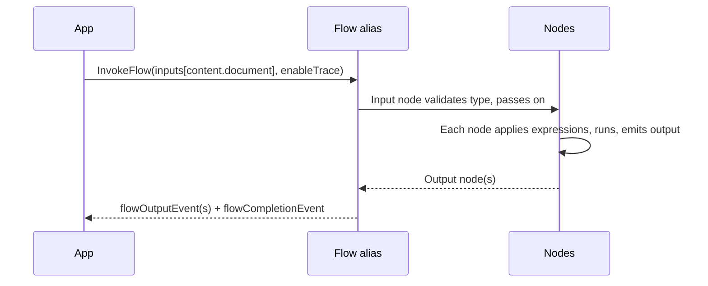

# Bedrock Flows (Prompt Flows)

Visual workflow builder that links prompts, FMs, knowledge bases, agents, Lambda, S3 and other services into one invocable pipeline. Defined by nodes and connections; deployed as immutable versions behind aliases.

> **Mental model:** a flowchart that AWS executes for you. Each box is a step (a prompt, a retrieval, a function); arrows carry data; diamonds branch.

**Key Concepts:**
- **Flow**: name, description, service role, nodes, connections. Input travels node to node until an Output node.
- **Node**: one step; has typed inputs, outputs, configuration.
- **Data connection**: output of one node to input of another (solid line).
- **Conditional connection**: from a condition to a downstream node, used only if the condition is true (dotted).
- **Expression**: JSONPath subset that extracts the part of the incoming data a node input needs.
- **Branch**: output feeding multiple nodes, or a condition node. Each branch can yield its own output.
- **Upstream / downstream**: earlier / later nodes.

---

## Expressions

Every expression starts with `$.data` (the whole input).

| Whole input type | Allowed expression |
|---|---|
| String / Number / Boolean | Only `$.data` |
| Object / Array | Sub-selection, as below |

| Expression | Meaning | Example → result |
|---|---|---|
| `$.data` | Entire input | whole object |
| `.name` | Field | `$.data.numbers` → `[1,2,3,5,8]` |
| `[i]` | Index | `$.data.animals.reptiles[2]` → `iguana` |
| `[i, j]` | Several indices | `$.data.numbers[0,3]` → `[1,5]` |
| `[a:b]` | Slice (b exclusive) | `$.data.organisms.mammals[1:]` → `["horse","mouse"]` |
| `*` | Wildcard (results in an array) | `$.data.*.mammals` → array of arrays |

- At runtime Bedrock applies the expression, then **validates the result against the declared input type**. A type mismatch is a runtime error.
- Allowed types: `String`, `Number`, `Boolean`, `Object`, `Array`.

---

## How a Flow Runs

| Behavior | Detail |
|---|---|
| One Input node | Mandatory, flow must start with it |
| Output nodes | Several allowed (one per branch); each yields a `flowOutputEvent` |
| Multiple branches | A flow call can return several outputs |
| `InvokeFlow` limit | Runs until finished or **1 hour** timeout |
| Streaming result | Response is an event stream |
| Pricing | No flow fee on its own; pay for resources used (e.g. model invoked by a Prompt node) |

---

## Build → Test → Deploy

| Stage | What happens |
|---|---|
| Create | Name, role, nodes, connections. `DRAFT` working version + test alias `TSTALIASID` created automatically |
| Prepare | Applies latest changes to the working draft so it can be tested |
| Test | Invoke with sample input; `enableTrace` shows each node's input/output |
| Version | Immutable snapshot, numbered from 1 |
| Alias | Points at a version; apps call the alias via `InvokeFlow` |
| Roll back / upgrade | Change what the alias points to; no app change |

Full detail: [Deployment and Execution](04-Flow-Deployment-and-Execution.md). Node catalog: [Flow Nodes](03-Flow-Nodes.md).

---

## Flow Guardrails

| Node | How | Constraint |
|---|---|---|
| Prompt node | `guardrailConfiguration` in node config | Applies to prompt and response |
| Knowledge Base node | `guardrailConfiguration` | **Only when generating** (`RetrieveAndGenerate`), so `modelId` required |

---

## Need → Pick

| Need | Pick |
|---|---|
| Prompt chain A → B → C, no code | Flow with Prompt nodes, data connections |
| Branch on a model result | Condition node |
| Run a step per array item | Iterator node (+ Collector) |
| Retry-style repeat until a condition | DoWhile loop node (`maxIterations`) |
| Custom business logic | Lambda node (or Inline Code node) |
| RAG step in a pipeline | Knowledge Base node |
| Clarifying questions mid-flow | Agent node + multi-turn |
| Run longer than 1 hour | Flow executions (async, up to 24 h) |
| Complex agent reasoning loops, custom state | Step Functions / agent frameworks instead (see integration notes) |

**Prompt Flows vs Step Functions:**

| | Bedrock Flows | Step Functions |
|---|---|---|
| Focus | GenAI-native nodes (prompt, KB, agent) | General AWS orchestration |
| Build | Visual builder, low/no code | ASL / Workflow Studio |
| Bedrock integration | Built-in nodes | Service integrations / Lambda |
| Pick when | Linear/branching GenAI chains | Retries, error handling, human approval, broad service coverage |
