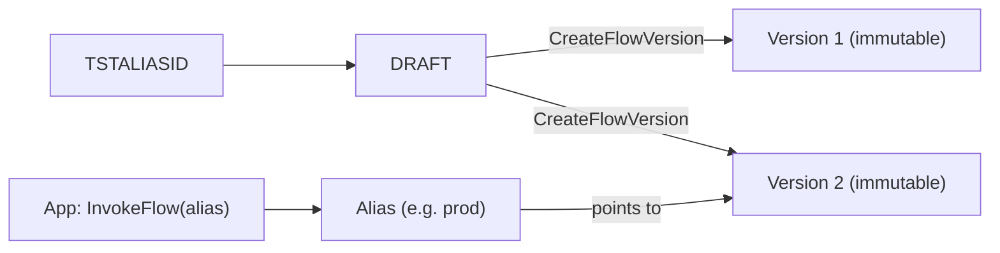
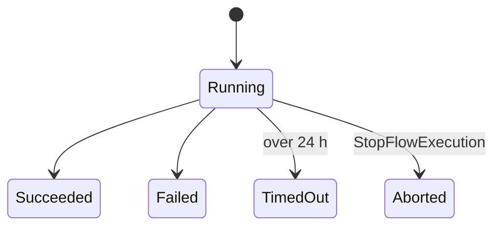
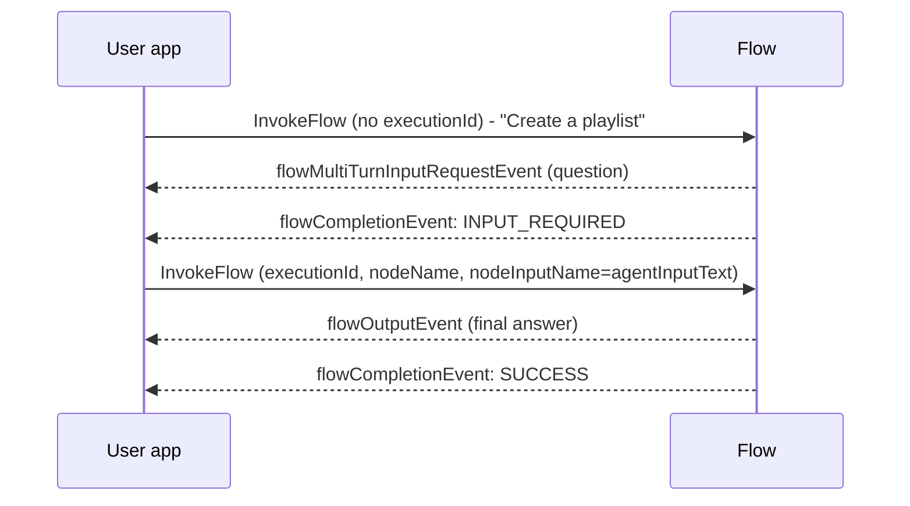

# Flow Deployment, Execution, and Tracing

How flows move from draft to production, run synchronously or asynchronously, hold multi-turn conversations, and are observed.

---

## Versions and Aliases

| Item | Behavior |
|---|---|
| `DRAFT` | Working copy; all edits land here |
| `TSTALIASID` | Test alias, auto-created, points to `DRAFT` |
| Version | Immutable snapshot; numbered from 1 |
| Alias | Pointer to a version; **what apps call** |
| Update production | New version from draft, then repoint alias |
| Roll back | Repoint alias to older version |

> [!WARNING]
> To change a deployed flow you must create a **new version**. Versions cannot be edited.

---

## Sync vs Async Execution

| | `InvokeFlow` | Flow executions (async) |
|---|---|---|
| Max duration | **1 hour** | Whole flow **24 hours**; each node **5 minutes** |
| Caller | Receives event stream | Starts, then polls |
| Start | `InvokeFlow` | `StartFlowExecution` |
| Status | stream ends | `GetFlowExecution` |
| Results | `flowOutputEvent` in stream | `ListFlowExecutionEvents` |
| Stop | n/a | `StopFlowExecution` |
| Debug snapshot | n/a | `GetExecutionFlowSnapshot` (definition at start) |
| Inline code node | Supported | **Not supported** |
| Release status | GA | **Preview** |

| Detail | Value |
|---|---|
| Statuses | `Running`, `Succeeded`, `Failed`, `TimedOut`, `Aborted` |
| Retention | Finished executions auto-deleted after **90 days** |
| Execution ARN | `arn:aws:bedrock:<region>:<acct>:flow/<FLOWID>/alias/<ALIASID>/execution/<name>` |
| Node errors | In `errors[]` with `nodeName`, `errorType` (e.g. `ExecutionTimedOut`), `message` |
| Event filter | `ListFlowExecutionEvents` `eventType=Flow` (input/output only) or `Node` (every node's I/O) |
| Encryption | Optional customer managed KMS key |

Pattern: start execution, poll `GetFlowExecution` until not `Running`, then read events. Take a snapshot when debugging, because the flow may be updated while an execution runs.

---

## Multi-Turn Conversations

Needs an **Agent node** whose agent has **user input enabled**. The agent can pause the flow to ask the user a question.

| Detail | Value |
|---|---|
| First call | Omit `executionId`; response returns it |
| Follow-ups | Send the same `executionId` + the Agent node's `nodeName` and `nodeInputName: agentInputText` |
| Pause signal | `flowMultiTurnInputRequestEvent` (always before the completion event) |
| Completion reasons | `INPUT_REQUIRED` (needs more), `SUCCESS` |
| Status | **Preview** |
| Not supported | Lex node multi-turn |

---

## Tracing

Set `enableTrace: true` on `InvokeFlow`. Each `flowOutputEvent` comes with `flowTraceEvent`s.

| Trace event | Shows |
|---|---|
| `FlowTraceNodeInputEvent` | Input a node received (+ `iterationIndex` between Iterator and Collector) |
| `FlowTraceNodeOutputEvent` | Output a node produced |
| `FlowTraceConditionNodeResultEvent` | Which conditions were satisfied (`satisfiedConditions`), so which branches fired |

Use for: finding the step that caused a bad result, spotting bottlenecks, validating branches.

---

## IAM: Flow Service Role

Trust policy principal: `bedrock.amazonaws.com`, with `aws:SourceAccount` and `AWS:SourceArn` (`flow/*`, narrow to the flow ID) conditions.

| Node / need | Permission (action) |
|---|---|
| Any model call | `bedrock:InvokeModel` on the model (+ `GetProvisionedModelThroughput` for Provisioned Throughput, `GetCustomModel` for custom models) |
| Prompt node using Prompt Management | `bedrock:RenderPrompt` on `prompt/<id>` |
| Knowledge Base node | `bedrock:Retrieve` |
| Agent node | `bedrock:InvokeAgent` on `agent-alias/<agentId>/<aliasId>` |
| S3 retrieval | `s3:GetObject` |
| S3 storage | `s3:PutObject` |
| Guardrails | `bedrock:ApplyGuardrail` |
| Lambda node | `lambda:InvokeFunction` |
| Lex node | `lex:RecognizeUtterance` |
| Encrypted resources | `kms:Decrypt`, `kms:GenerateDataKey` |

> [!WARNING]
> For flows created after **2024-11-22**, Lambda and Lex are invoked with the **flow service role** (not the Bedrock service principal), and prompts render via `bedrock:RenderPrompt` (not `GetPrompt`). Older flows need the role updated. The console-created role gets permissions added on save, but **never removes** ones you no longer need.

If the flow is KMS-encrypted, the key policy must also allow the flow role.

---

## Troubleshooting

| Symptom | Likely cause | Fix |
|---|---|---|
| Node fails with type error | Expression result does not match declared input type | Fix expression or input type |
| Flow ends early with 1-hour limit | Long chain through `InvokeFlow` | Use flow executions (24 h) |
| Lambda/Lex/prompt node access denied | Missing action on flow service role | Add `lambda:InvokeFunction` / `lex:RecognizeUtterance` / `bedrock:RenderPrompt` |
| Unexpected branch taken | Condition order | First true condition wins; check trace `satisfiedConditions` |
| Inline code node rejected in async run | Unsupported in executions | Use Lambda node |
| KB node guardrail ignored/invalid | Retrieval-only mode | Set `modelId` so it uses `RetrieveAndGenerate` |
| Prod behaves like latest edits | App calls `TSTALIASID` (points to `DRAFT`) | Call a prod alias that points to a numbered version |

---

## Need → Pick

| Need | Pick |
|---|---|
| Safe release and instant rollback | Version + alias repoint |
| Test latest edits | `TSTALIASID` on `DRAFT` |
| Job over 1 hour | `StartFlowExecution` |
| Debug node-by-node | `enableTrace` (sync) or `ListFlowExecutionEvents eventType=Node` (async) |
| Ask the user mid-flow | Agent node + multi-turn |
