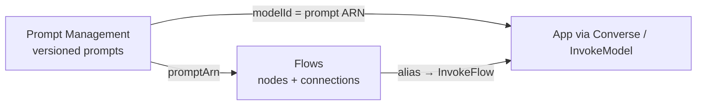

# Bedrock Prompt Management and Flows

Prompt Management stores and versions individual prompts; Flows chains prompts, models, knowledge bases, agents, and code into a deployable workflow. Flows consume managed prompts through Prompt nodes.

| File | Content |
|---|---|
| `01-Prompt-Management.md` | Prompt resource, variants, versions, running by ARN, `OptimizePrompt`, governance pattern |
| `02-Prompt-Flows.md` | Flow concepts, expressions, run model, Flows vs Step Functions |
| `03-Flow-Nodes.md` | Every node type, I/O names and types, per-node guardrails, limits |
| `04-Flow-Deployment-and-Execution.md` | Versions/aliases, async executions, multi-turn, tracing, service role |

**Prompt Management vs Prompt Flows:**

| | Prompt Management | Prompt Flows |
|---|---|---|
| Manages | One prompt (+ variants, versions) | A multi-node workflow |
| Runs via | `Converse` / `InvokeModel` with prompt ARN | `InvokeFlow` on an alias |
| Versioning | Prompt versions | Flow versions + aliases |
| Role | Reusable building block | Consumes prompts via Prompt nodes |

**Pending:** Amplify/OpenAPI interfaces (2.5.2), Step Functions approval pattern (1.6.3), A/B testing with evaluations (3.4.2).
