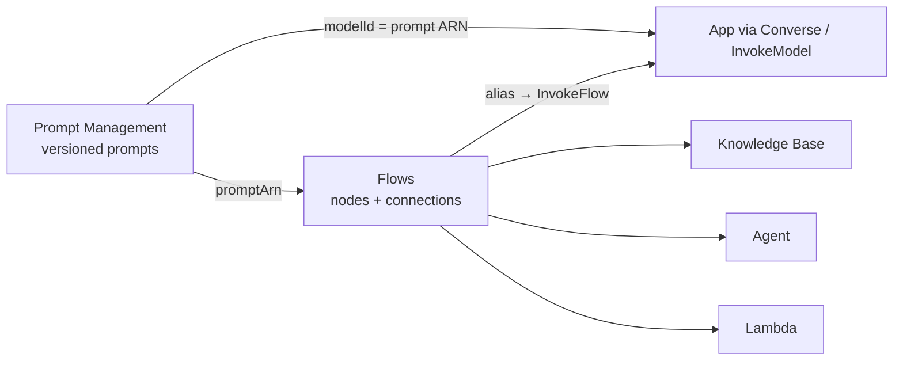

# Bedrock Prompt Management and Flows

Prompt Management stores and versions individual prompts; Flows chains prompts, models, knowledge bases, agents, and code into a deployable workflow. Flows consume managed prompts through Prompt nodes.

| File | Content |
|---|---|
| `01-Prompt-Management.md` | Prompt resource, variants, versions, running by ARN, Converse restrictions, `OptimizePrompt`, governance pattern |
| `02-Prompt-Flows.md` | Flow concepts, expressions, run model, build/test/deploy, guardrails, Flows vs Step Functions |
| `03-Flow-Nodes.md` | All node types with I/O names and types, condition operators, inline code limits |
| `04-Flow-Deployment-and-Execution.md` | Versions/aliases, async executions, multi-turn, tracing, flow service role, troubleshooting |

Related: prompt caching and routing in [06-Inference-Throughput-and-Routing](../06-Inference-Throughput-and-Routing/README.md).

## Need → Pick

| Need | Pick |
|---|---|
| Central, versioned prompt reused by many callers | Prompt Management |
| Multi-step GenAI workflow, low code | Flows |
| Safe flow release / rollback | Flow version + alias |
| Job longer than 1 hour | Flow executions (async, 24 h) |
| Hand-written retries, human approval, wide service integration | Step Functions |

**Pending:** Amplify/OpenAPI interfaces (2.5.2), approval-workflow patterns with Step Functions (1.6.3), Prompt Management A/B testing with evaluations (3.4.2).
