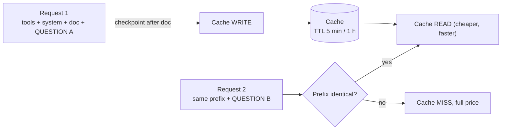

# Bedrock Prompt Caching

Reuses the already-processed static prefix of a prompt across requests to cut input-token cost and latency. Best for long repeated context: system prompts, tool definitions, uploaded documents in a chat.

> **Mental model:** a bookmark in the prompt. Everything before the bookmark is processed once and stored; later requests with the *identical* prefix skip reprocessing.

---

## Two Types

| | Implicit | Explicit |
|---|---|---|
| How | Bedrock/model auto-reuses eligible prefixes | You mark prefixes with cache checkpoints / breakpoints |
| Request changes | None | Model-specific cache controls |
| Guarantee | Best effort, no hit guarantee | Control over *what* is eligible; still no hit guarantee |
| Tip | Static content first, dynamic last | Put checkpoint **after stable content** |

> [!WARNING]
> Supporting prompt caching never guarantees a hit. Check the usage fields in the response.

---

## Explicit Caching Rules

| Rule | Detail |
|---|---|
| Checkpoint minimum | Cumulative prefix must reach the model's minimum tokens; **512–4,096** depending on model |
| Below minimum | Request succeeds, but **nothing is cached** |
| Max checkpoints | **4** per request for Claude and Nova (OpenAI GPT-5.6+: 4 cache writes) |
| Spacing | No minimum tokens *between* checkpoints, only cumulative prefix minimum |
| Processing order | `tools` → `system` → `messages` |
| Invalidation chain | Changing `tools` invalidates `system` and `messages` caches; changing `system` invalidates `messages` |
| TTL | Resets on each hit; many models **5 min**; some Claude models also **1 hour** |
| TTL field | Converse `cachePoint.ttl: "1h"`; InvokeModel Claude `cache_control.ttl: "1h"` |
| TTL gotcha | Sending `ttl` to a 5-minute-only model can raise `ValidationException`; omit it |
| Mixed TTLs | Allowed, but **longer TTL entries must come before shorter** |
| Nova cap | Max **20K tokens** cacheable; primarily text |
| Anthropic simplified mode | One checkpoint at end of static content; auto-looks back ~**20 content blocks** for the longest match |
| Not supported | **Batch inference** (on-demand endpoints only) |
| With cross-region inference | Works; at high demand may cause **more cache writes** |

> [!NOTE]
> Always read the model's card for exact minimums and TTLs; they vary per model and change over time.

---

## Where to Set Checkpoints

| API | Marker |
|---|---|
| Converse / ConverseStream | `{"cachePoint": {"type": "default"}}` as a block in `system`, `messages[].content`, or `toolConfig.tools` |
| InvokeModel (Claude) | `"cache_control": {"type": "ephemeral"}` on a content block |
| InvokeModel (Nova) | `"cachePoint": {"type": "default"}` in content |
| Prompt Management | `CHAT` template option: None / Tools / Tools+system / Tools+system+messages |
| Console playground | Prompt caching toggle; checkpoints created automatically |

---

## Reading the Response

| Field (Converse) | Meaning |
|---|---|
| `cacheReadInputTokens` | Tokens served from cache |
| `cacheWriteInputTokens` | Tokens written to cache |
| `cacheDetails` | TTL used for written tokens |
| `inputTokens` | **Non-cached** input tokens only |

**Total input tokens = `inputTokens` + `cacheReadInputTokens` + `cacheWriteInputTokens`**

---

## Billing and Limits

| Item | Behavior |
|---|---|
| Cache read | Billed at the model's (lower) cache-read rate |
| Cache write | Some models bill above the standard input rate (e.g. GPT-5.6+ at 1.25×) |
| Uncached tokens | Standard input rate |
| Rate limits | Anthropic: cache hits not deducted from rate limit; OpenAI: cached tokens don't count against input-tokens-per-minute |
| 5-min vs 1-hour | If reused more often than every 5 min, stay on 5-min (refreshes free); 1-hour for gaps >5 min but <1 h |

---

## Troubleshooting

| Symptom | Likely cause | Fix |
|---|---|---|
| No cache reads | Prefix below model minimum | Pad/extend stable prefix or choose model with lower minimum |
| Misses on every call | Dynamic text (timestamp, user name) early in prompt | Move dynamic content after the checkpoint |
| Misses after editing tools | Earlier section changed | Treat `tools` and `system` as frozen |
| `ValidationException` | `ttl` on a 5-minute-only model | Omit `ttl` |
| Match not found | Static content longer than ~20 blocks from checkpoint | Add more checkpoints or restructure |
| Cache seems cold after idle | TTL expired | Use 1-hour TTL or keep-warm traffic |
| Unexpected extra write cost | Cross-region inference at peak, or unstable prefix | Stabilize prefix; monitor `cacheWriteInputTokens` |

---

## Need → Pick

| Need | Pick |
|---|---|
| Long system prompt reused constantly | Explicit checkpoint at end of `system`, 5-min TTL |
| Chat with uploaded doc, user replies slowly | Checkpoint after doc, 1-hour TTL |
| No code change, accept uncertainty | Implicit caching (static first) |
| Different parts change at different rates | Multiple checkpoints (max 4), stable first |
| Batch job | Not supported; use other optimizations |
| Prompts managed centrally | Prompt Management `CHAT` template with caching option |

**Prompt caching vs Semantic caching:**

| | Prompt caching (Bedrock) | Semantic caching (app-built) |
|---|---|---|
| Caches | Processed prompt **prefix** | Whole **responses** |
| Hit rule | Identical prefix | Similar meaning (vector match) |
| Skips model call | No, reduces cost/latency of it | Yes |
| Build | Built-in flag | You build (e.g. vector store + similarity threshold) |
