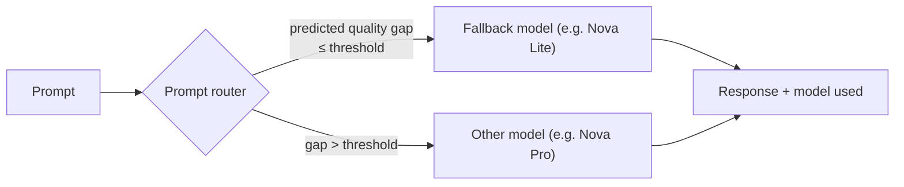

# Bedrock Intelligent Prompt Routing

One serverless endpoint that sends each request to the model, within one model family, predicted to give the best quality-for-cost. Replaces hand-written model-selection logic for simple tiering.

> **Mental model:** a triage nurse. Easy prompts go to the cheap model; hard ones go to the stronger model, decided per request from a predicted quality gap.

---

## Router Types

| | Default router | Configured router |
|---|---|---|
| Created by | Bedrock (pre-built) | You (`CreatePromptRouter`) |
| Models | Select Amazon Nova or Meta Llama models (varies by Region) | Models you pick, **exactly two, same family** |
| Tuning | None | Routing criteria + fallback model |
| Start with | Yes, experiment here first | After testing defaults |

---

## Routing Criteria

| Term | Meaning |
|---|---|
| **Fallback model** | Reliable baseline/anchor; used when the criteria is not met |
| **Response quality difference** | How much better the other model's *predicted* response must be before the router switches to it |
| Small value | Switch to the other model easily |
| Large value | Stay on fallback unless the gain is big |

**Worked example:** fallback = Nova Lite, quality difference = 10%. Router sends to Nova Pro only when Nova Pro's predicted quality is **more than 10% better** than Nova Lite's; otherwise Nova Lite answers.

---

## How a Request Flows

| Step | What happens |
|---|---|
| 1 | Pick a model family / router |
| 2 | Router analyzes the prompt content and context |
| 3 | Predicts response quality per model |
| 4 | Applies criteria; chooses best quality-cost option |
| 5 | Forwards to chosen model |
| 6 | Returns response, including **which model handled it** |

---

## Setup

| Item | Detail |
|---|---|
| Create | `CreatePromptRouter` / `aws bedrock create-prompt-router` with `--models`, `--fallback-model`, `--routing-criteria '{"responseQualityDifference": 0.5}'` |
| Manage | `GetPromptRouter`, `ListPromptRouters`, `DeletePromptRouter` |
| Console | Prompt Routers hub; choose exactly two models in one family |
| Models (examples in docs) | Amazon Nova Lite/Pro; Meta Llama 3.1 8B/70B, Llama 3.3 70B |
| Invoke | Send prompts to the router (its ARN is used in place of a model ID) |

> [!WARNING]
> Limits: tuned for **English** prompts only; cannot adapt to your app's own performance data; routing quality depends on its training data and can be suboptimal for specialized domains.

---

## Router vs Alternatives

| Approach | Decides by | Effort | Adapts to your metrics |
|---|---|---|---|
| Intelligent Prompt Routing | Predicted response quality per prompt | Config only | No |
| Static routing in code | Fixed rule (use case, user tier) | Code | Manual |
| Step Functions content-based routing | Your classifier / rules | Build workflow | Yes (you encode it) |
| Model cascading | Try cheap model, escalate on low confidence | Build | Yes (you encode it) |

## Need → Pick

| Need | Pick |
|---|---|
| Cut cost, mixed easy/hard prompts, Nova or Llama | Default router, then configured router |
| Control the quality/cost threshold | Configured router (`responseQualityDifference`, fallback) |
| Non-English or domain-specific routing | Custom routing (code / Step Functions) |
| Route by business rule (tenant, task type) | Static or content-based routing |
| Need routing driven by your own evaluation data | Custom routing + Model Evaluation results |
