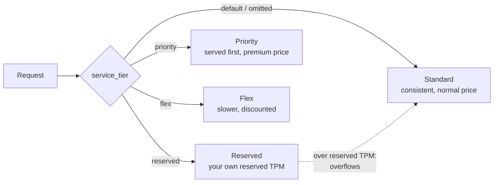

# Bedrock Service Tiers

A **service tier** is a per-request choice of how Bedrock serves an on-demand model call: pay more for speed or guaranteed capacity, or pay less if the work can wait. There are **four**: Reserved, Priority, Standard, Flex.

You choose with one optional request parameter:

```
"service_tier": "reserved | priority | default | flex"
```

Omit it and you get **Standard**.



## The four tiers

| Tier | Best for | Price | Capacity |
|---|---|---|---|
| **Reserved** | Mission-critical apps that **cannot tolerate downtime** | **Fixed price per 1K tokens-per-minute (TPM)**, billed monthly | Your own reserved capacity, **separate from on-demand quota** |
| **Priority** | Customer-facing flows needing the **fastest responses**, without 24x7 reservation | **Premium** over standard | Shares on-demand quota, but **served ahead of Standard and Flex** |
| **Standard** | Everyday work: content generation, text analysis, document processing | Normal on-demand | Default |
| **Flex** | Work that can wait: **model evaluations, summarization, agentic workflows** | **Discount** | Shares on-demand quota, lowest priority (longer processing times) |

## Reserved details

- Targets **99.5% uptime** for model responses.
- Terms of **1 month or 3 months**; set **input and output TPM separately**. Minimums: **100,000 input TPM** and **10,000 output TPM**.
- Demand above your reservation **overflows to Standard** automatically, so traffic isn't dropped.
- Not self-serve: contact your **AWS account team**. Billing continues until your account manager deletes the reservation.
- When sizing, TPM counts `InputTokenCount` **plus** `CacheWriteInputTokens`, so add both from CloudWatch if you use prompt caching.

## Seeing and controlling it

- The tier that served a request shows in the **API response** and **CloudTrail**.
- CloudWatch metrics have dimensions `ModelId`, `ServiceTier` and **`ResolvedServiceTier`** (the tier that **actually** served it, which can differ from what you asked for, for example after Reserved overflow).
- Support varies **per model**; check the model's page.
- IAM can **restrict who may use which tier** (identity policies for service tiers).
- **Priority, Standard and Flex share one on-demand quota** per model; Reserved is separate.

## Tiers vs the other levers

| Need | Use |
|---|---|
| Per-request speed or price choice, no commitment | **Priority / Flex** |
| Guaranteed capacity, still on-demand models, token-based | **Reserved** |
| Guaranteed throughput for a **custom or imported model** (or fixed model units) | [Provisioned Throughput](03-Provisioned-Throughput.md) |
| Cheapest for large, non-urgent jobs | Batch inference (pending note) |
| Cut repeated-prefix cost and latency | [Prompt caching](01-Prompt-Caching.md) |

Rule of thumb: interactive and customer-facing → Priority (or Reserved for hard guarantees); background, evaluation and bulk work → Flex; everything else → Standard.
