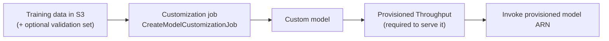

# Bedrock Model Customization

Bedrock lets you train a supported foundation model further on your own data without managing training infrastructure, producing a **custom model** that only your account can use. Use it when prompting and RAG can't fix the problem because the model must *learn* a behavior (see [Choosing a Customization Approach](../../01-GenAI-Fundamentals/Choosing-a-Customization-Approach.md)).

---

## The customization methods

**Supervised fine-tuning.** You provide **labeled** examples: for each input, the output you want. The model's parameters are adjusted so it learns to produce that kind of output for that kind of input. Use it for domain style, rigid formats, and consistent handling of niche cases.

**Reinforcement fine-tuning.** Instead of fixed answers, you define **reward functions** (implemented in AWS Lambda) that score how good a response is, and the model learns iteratively from those scores. You supply a prompt dataset or reuse existing Bedrock invocation logs. Useful when quality is easier to *score* than to *write out* as an ideal answer.

**Distillation.** A large **teacher** model's answers are used to fine-tune a smaller, faster, cheaper **student** model. You choose the teacher and student and provide prompts that represent your use case; Bedrock generates the teacher responses (and you may add your own labeled prompt-response pairs). Goal: teacher-like quality at student cost and latency.

> [!NOTE]
> Current Bedrock docs list these three methods. Continued pre-training on large unlabeled data is a general technique, but it is not one of the options listed here.

---

## Running a fine-tuning job

- **Data**: examples in S3; you can supply a separate validation set (or hold out a share) so the job reports whether the model is improving or overfitting.
- **Hyperparameters**: knobs that control training. They differ per model, so start from the defaults.
  - **Epochs**: how many passes over the whole dataset. More epochs cost more tokens and can overfit.
  - **Learning rate**: how big each weight update is. Too high destabilizes training.
  - **Batch size**: samples processed before each update.
  - **Warmup steps**: iterations over which the learning rate ramps up to its set value (avoid a large warmup on a small dataset, or it never reaches full rate).
  - **Early stopping** (threshold and patience, on some models): stop when validation loss stops improving.
  - Example, Amazon Nova: epochs 1–5 (default 2), learning rate 1e-6 to 1e-4 (default 1e-5), warmup 0–100 (default 10). Larger datasets generally need fewer epochs.
- **Models**: a subset of foundation models can be tuned, including Amazon Nova, Anthropic Claude 3 Haiku, and Meta Llama 3.x, and mostly only in specific Regions. Check the current list before planning.
- **Cost**: you pay for training tokens (**tokens in the training data × epochs**) plus **monthly storage per custom model**.

---

## Serving a custom model

A custom model **must be served with Provisioned Throughput**, which bills hourly (same hourly price as the base model) until you delete it. This is the main cost difference from LoRA hosting on SageMaker, where many adapters share one endpoint. See [Provisioned Throughput](../06-Inference-Throughput-and-Routing/03-Provisioned-Throughput.md).

---

## Custom Model Import

Brings a model you trained **outside Bedrock** (for example in SageMaker) into Bedrock so you can call it with Bedrock APIs.

- **Patterns**: a fine-tuned model (same architecture, new weights), domain or language adaptation (often vocabulary changes), or a model pre-trained from scratch.
- **Supported architectures** include Llama 2/3.x, Mistral, Mixtral, Flan-T5, Qwen2/2.5/3, GPT-BigCode, and GPT-OSS (20B and 120B, US East N. Virginia only).
- **Source files** (Hugging Face format) in S3: `.safetensors` weights, `config.json`, and tokenizer files.
- **Limits**: weights under 200 GB for text models (100 GB multimodal); context length under 128K; transformers library version 4.51.3; **embedding models are not supported**.
- **Invocation**: `InvokeModel` / `InvokeModelWithResponseStream`, with **on-demand throughput** (no Provisioned Throughput needed). Not usable with batch inference or CloudFormation. Available in a few Regions (eu-central-1, us-east-1, us-east-2, us-west-2).

---

## Customization vs import vs adapters

| | Bedrock fine-tuning | Custom Model Import | SageMaker LoRA adapters |
|---|---|---|---|
| Where you train | Bedrock (managed) | Anywhere, you bring weights | SageMaker (you control training) |
| What you get | Full custom model | Imported full model | Small adapter on a shared base |
| Serving | Provisioned Throughput (hourly) | On-demand | Inference components on your endpoint |
| Frequent small updates | Heavy (a new custom model) | Heavy (re-import) | Light (swap an adapter) |
| Effort | Lowest | Medium | Highest, most control |

For frequent updates, safe rollback, and several variants sharing one base model, adapters on SageMaker fit best: [LoRA Adapter Lifecycle](../../04-SageMaker-for-GenAI/01-LoRA-Adapter-Lifecycle.md).
