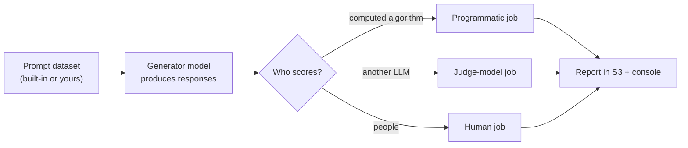

# Amazon Bedrock Evaluations

Model evaluation answers "is this model (or this retrieval setup) good enough for my use case, and is one better than another?" with measured scores instead of impressions. You give it a set of prompts, it runs them through the model, scores the responses, and writes a report. It is how you compare models before choosing one, and how you check that a change (new model, new prompt) didn't make things worse.

There are four kinds of job. They differ in **who does the scoring**.

---

## The four job types

- **Programmatic (automatic)**: scores are computed with standard algorithms against built-in or custom datasets. Fast and cheap, but limited to a fixed set of metrics.
- **Judge model (LLM-as-a-judge)**: a second model, the **evaluator**, scores each response of the **generator** model and explains why. This needs two different models. Flexible, with built-in and custom metrics.
- **Human**: your own employees or subject-matter experts rate responses. Best for subjective or sensitive qualities and for checking that an automated judge agrees with people.
- **RAG evaluation**: scores a Knowledge Base, or a RAG source outside Bedrock, on retrieving relevant information and generating useful answers. The dataset must include ground truth (expected retrieved text and expected answers).

Generators can be foundation models, Marketplace models, customized or imported models, prompt routers, and Provisioned Throughput models. For a model outside Bedrock (judge jobs), put your own responses in the dataset; Bedrock skips the invoke step and scores what you supplied.

---

## Programmatic jobs: tasks, metrics, datasets

One **task type** per job. Each task offers accuracy, robustness, and toxicity, computed on built-in datasets (or your own).

| Task | Accuracy | Robustness | Toxicity | Built-in datasets |
|---|---|---|---|---|
| General text generation | Real-world knowledge score | Word error rate | Toxicity score | T-REX, BOLD, WikiText2, RealToxicityPrompts |
| Summarization | BERTScore | BERTScore and deltaBERTScore | Toxicity score | Gigaword |
| Question and answer | NLP-F1 | F1 and deltaF1 | Toxicity score | BoolQ, NaturalQuestions, TriviaQA |
| Classification | Classification accuracy | Accuracy and its delta | n/a | Women's E-Commerce Clothing Reviews |

*Robustness* measures how much the score changes when the prompt is slightly perturbed; the "delta" metrics are that change. A model whose answers swing with trivial rewording is not dependable.

---

## Judge-model metrics

Each built-in metric uses its own judge prompt and scores every response. You can also define **custom metrics** for business-specific criteria.

| Group | Metrics (what each checks) |
|---|---|
| Quality | **Correctness**, **Completeness** (answers every question in the prompt), **Faithfulness** (nothing beyond the given context), **Helpfulness**, **Logical coherence**, **Relevance**, **Following instructions**, **Professional style and tone** |
| Responsible AI | **Harmfulness** (harmful content), **Stereotyping** (stereotypes, positive or negative), **Refusal** (response declines or rejects the request) |

If your dataset includes a reference answer (ground truth), the judge uses it when scoring correctness and completeness. The console shows a score histogram and explanations for the first five prompts; the full report is in the S3 bucket you chose.

> [!NOTE]
> A judge is itself a model and can be biased or inconsistent. Use human evaluation on a sample to confirm the judge's scores track human opinion.

---

## Practical notes

- The S3 bucket needs the required CORS permissions for the console to show results.
- Evaluation data and results are encrypted; a customer managed key can be used.
- Evaluation job management calls appear as CloudTrail management events.
- Which models can act as evaluators depends on the metric type and Region; check the current list before choosing a judge.

Applying these metrics to detect unfair output across groups, continuously: [Fairness and Bias Monitoring](../../09-Security-Governance-Responsible-AI/01-Fairness-and-Bias-Monitoring.md).
