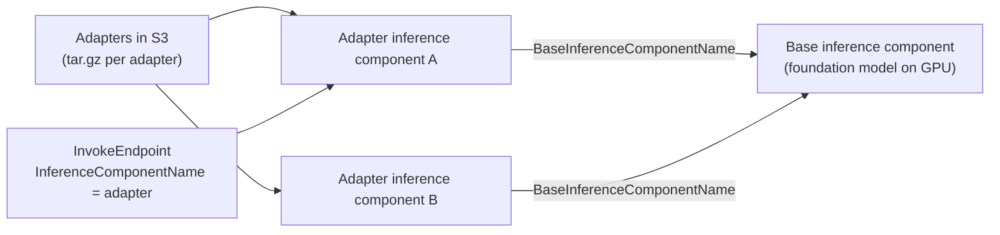
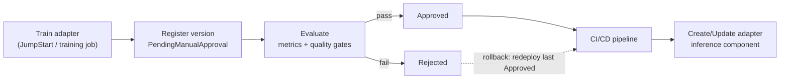

# LoRA Adapters on SageMaker: Training, Versioning, Deployment

Customizing a large model by retraining all of it is expensive, and every update produces another giant artifact to store, test, and deploy. **LoRA (low-rank adaptation)** avoids that: it freezes the base model and trains only a small set of extra weights, an **adapter**, that nudges the base model's behavior. Because the adapter is a tiny separate file, you can version it, deploy it, and roll it back independently, and many adapters can share one copy of the base model.

---

## What a LoRA adapter is

A big model's weight matrices are huge, but the *change* needed to adapt the model to a new task can be described with far fewer numbers (a low-rank update). LoRA learns just that update. At inference the base model plus the adapter behaves like a fine-tuned model.

What this buys you:
- **Cheap training**: only the small adapter is trained, so far less compute and time than full fine-tuning.
- **Small artifacts**: the adapter is a fraction of the base model's size.
- **Independent lifecycle**: base model and adapters are versioned, promoted, and retired separately.
- **Many variants, one base**: different teams, environments, or tasks each get an adapter.

**Worked example (AWS Llama 2 7B case).** The base weights are about 13 GB; each task adapter is about 0.6 GB. Keeping base and adapters separate saves about 95% of storage versus merging adapter into base for each variant, which duplicates roughly 96% of the model every time.

In JumpStart fine-tuning, LoRA is controlled by hyperparameters:
- `lora_r`: the adapter's rank (its capacity; a higher value learns more but is larger).
- `lora_alpha`: scaling of the update, generally 2 to 4 times `lora_r`.
- `lora_dropout`: regularization to reduce overfitting.
- Related options: `int8_quantization` (load the model in 8-bit to save memory) and `enable_fsdp` (sharded training across GPUs).

JumpStart offers two fine-tuning styles: **instruction fine-tuning** (prompt-and-response examples) and **domain adaptation** (training on domain text).

---

## Versioning with SageMaker Model Registry

Model Registry is the catalog that gives you versions, approvals, and an audit trail.

- A **model group** (model package group) holds all versions of one thing; each registration adds a **model version**.
- You can register the **base model** in one group and each **adapter** in another, then use **collections** to link adapters to their base for discovery at scale.
- Each version carries training parameters, validation metrics, and lineage (SageMaker Experiments can record loss and hyperparameters), so you can see exactly what produced it.
- A version has an **approval status**, and changing it is the control point for deployment.

| Status change | What happens (with SageMaker project templates) |
|---|---|
| `PendingManualApproval` → `Approved` | Starts CI/CD deployment of that version |
| `PendingManualApproval` → `Rejected` | Nothing |
| `Rejected` → `Approved` | Starts CI/CD deployment |
| `Approved` → `Rejected` | Starts CI/CD to deploy the latest version that is still `Approved` |

The last row is the **rollback mechanism**: reject the bad version and the pipeline redeploys the previous approved one. A pipeline can set the status automatically from an evaluation (a condition step), or a person can approve it.

---

## Hosting many adapters on one endpoint

SageMaker **inference components** let one endpoint host a base model and many adapters.

- First deploy the **base inference component** to an endpoint.
- Create an **adapter inference component** with `CreateInferenceComponent`, giving the `BaseInferenceComponentName` and the S3 location of the adapter (`ArtifactUrl`). You omit compute requirements: the adapter **uses the base component's compute**.
- Call it with `InvokeEndpoint` and the adapter's `InferenceComponentName`; SageMaker combines the adapter with the base model for that request.
- **Dynamic loading**: adapters are loaded on demand and moved between GPU memory, CPU memory, and local disk (limits such as `OPTION_MAX_LORAS` and `OPTION_MAX_CPU_LORAS` control how many stay where), so hundreds of adapters can sit behind one endpoint. Reported added latency versus calling the base model was up to about 10%.
- **Atomic changes**: add, update (`UpdateInferenceComponent` replaces adapter artifacts), or delete (`DeleteInferenceComponent`) an individual adapter on a running endpoint with no redeploy of the base model. Each adapter has its own metrics.
- No extra charge for the feature itself.

---

## The end-to-end pipeline

Lifecycle in plain steps:
1. **Train** a new adapter on updated data; the base model is untouched.
2. **Register** it as a new version in the adapter's model group with its metrics.
3. **Evaluate** automatically (quality gates, regression tests); set `Approved` or `Rejected`.
4. **Deploy** through the pipeline by creating or updating that adapter's inference component. Use separate model groups or approval flows per environment (dev, staging, prod) so variants coexist across environments.
5. **Roll back** by rejecting the bad version (the pipeline redeploys the last approved one) or by pointing the adapter component back to the previous artifact, with no change to the base model.
6. **Retire** an adapter by deleting its inference component and rejecting or removing its registry versions. Replacing the **base model** is a separate, rarer change that requires retraining adapters against the new base.

> [!WARNING]
> An adapter is tied to the base model it was trained on. If you upgrade the base model, existing adapters must be retrained against it.

---

## Why this beats the alternatives for frequent, low-risk updates

- **Full fine-tuning**: every update is a complete new model, trained, stored, and deployed as a new endpoint; rollback means redeploying a full model. Higher cost, slower cycle.
- **Continued pre-training**: designed for large, broad domain shifts on huge unlabeled corpora; too slow and costly for frequent targeted updates.
- **RAG**: adds knowledge to prompts but doesn't teach learned patterns, and its changes are prompt/index changes, not versioned model behavior.

How the options compare and when to use each: [Choosing a Customization Approach](../01-GenAI-Fundamentals/Choosing-a-Customization-Approach.md). Bedrock's managed route and its hosting model: [Bedrock Model Customization](../02-Amazon-Bedrock/07-Model-Customization/01-Bedrock-Model-Customization.md).
