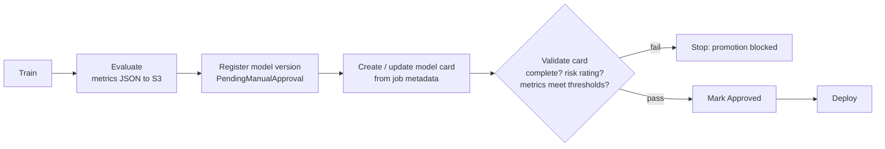

# SageMaker Model Cards in the CI/CD Pipeline

A **model card** is the model's fact sheet: what it is for, what it must not be used for, how it was trained and evaluated, and how risky it is. Regulators and risk teams want one for every model, and it must match the model that is actually deployed.

**Remember:** to make it mandatory, the pipeline **creates the card from job metadata** and **blocks promotion** until the card passes validation. Anything manual or non-blocking leaves a gap.

---

## What a card holds

- **Model overview**: description, owner, creator, problem type.
- **Intended uses**: purpose, intended use cases, factors affecting performance, **risk rating** (`Unknown`, `Low`, `Medium`, `High`) and why.
- **Training details**: job ARN, datasets, hyperparameters, objective function, training metrics.
- **Evaluation details**: metric groups per evaluation job. Clarify or Model Monitor JSON reports can be attached from S3, or your own report in the model card JSON schema.
- **Additional information**: ethical considerations, caveats, recommendations, custom fields (for example "Line of business").

## The API

| Need | Call |
|---|---|
| Create / change | `CreateModelCard`, `UpdateModelCard` |
| Read | `DescribeModelCard`, `ListModelCards`, `ListModelCardVersions` |
| PDF for auditors | `CreateModelCardExportJob` (+ describe/list) |
| Remove | `DeleteModelCard` |

- With the low-level API (and CLI) the **content is a JSON string in the model card schema**. The Python SDK offers helper classes.
- A new card starts as **`DRAFT`** unless you set a status.
- Pass a **model package** (Model Registry) and the card auto-imports its details, such as group, version and artifact location. Version your packages and make a card per version; earlier cards' content carries over.
- **Edits create a new immutable version** of the card (only an approval-status change doesn't), which gives the audit trail. One model name has one card.

---

## The gated pipeline

1. Training and evaluation jobs produce the data (metrics, datasets, hyperparameters) that the card is built from, so nobody retypes it.
2. A pipeline step calls `CreateModelCard` or `UpdateModelCard` with that data and links the model package.
3. A **validation step** fails the pipeline if required fields are missing, no risk rating is set, or metrics are below the agreed bar.
4. Only after validation passes is the card/version approved and the deployment stage allowed to run.
5. Store the card (and optional PDF) with the model version so any production model traces back to its documentation.

Make "blocking" real: put the check in the pipeline itself (a SageMaker Pipelines condition step, or a CodePipeline stage running CodeBuild or Lambda), and let only the pipeline role deploy to production.

> [!WARNING]
> A card step that can fail without stopping the pipeline, or a console step a human must remember, is not a control. Also, custom IAM policies for Studio need tagging permissions or card creation can fail with `AccessDenied`.

## Why the other designs fail

- **Manual console creation after export:** slow and skippable.
- **Non-blocking step with default templates:** incomplete cards still ship.
- **Lambda that only notifies the compliance team:** humans write the cards; nothing enforces them.

Registry approvals and rollback: [LoRA Adapter Lifecycle](01-LoRA-Adapter-Lifecycle.md). Using cards to record fairness results: [Fairness and Bias Monitoring](../09-Security-Governance-Responsible-AI/01-Fairness-and-Bias-Monitoring.md).
