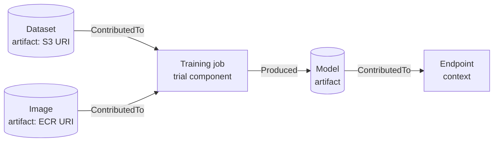

# SageMaker ML Lineage Tracking

**ML Lineage Tracking** automatically records the steps of an ML workflow, from data preparation to deployment, as a **graph**. You can then ask "which data trained this model?" or "which endpoints are affected if this dataset is bad?". It is the audit trail behind governance and reproducibility.

Reading the graph: the dataset is an **ascendant** of the model; the endpoint is a **descendant**.

## The building blocks

- **Artifact**: a thing with an address: a dataset (S3 URI), an image (ECR path), a model.
- **Action**: an activity, usually with an input or output artifact: a workflow step, a model deployment, a model approval.
- **Context**: a logical group: an endpoint, a model package, or an experiment or trial.
- **Trial component**: represents a **processing, training, or batch transform job** and holds its parameters. Trials and experiments group these.
- **Association**: the **edge** between two entities. Its optional `AssociationType`:

| Type | Meaning | Example |
|---|---|---|
| `ContributedTo` | Source helped enable the destination | Training data → training job |
| `Produced` | Source generated the destination | Training job → model artifact |
| `DerivedFrom` | Destination is a modification of the source | Processed output from a raw input |
| `AssociatedWith` | Connected, no direction of cause | Approval workflow ↔ deployment |
| `SameAs` | Same entity seen from different accounts | Cross-account lineage |

Every artifact, action and context has a **type** string, a **source** (the underlying URI or ARN), and optional **metadata** (`ProjectId`, `GeneratedBy` such as the pipeline execution, `Repository`, `CommitId`). SageMaker **reuses** an existing entity instead of duplicating it, so there is one artifact per unique `SourceUri`.

## Created for you vs by hand

- **Automatic**: processing, training and batch transform jobs, SageMaker Pipelines steps, model registration, and endpoints create their entities and associations.
- **Manual**: use `CreateArtifact`, `CreateAction`, `CreateContext`, `AddAssociation` for **custom steps** outside SageMaker (a data export, a manual review) so the chain isn't broken.

## Querying: `QueryLineage`

Give it a start point and a direction; it walks the graph.

| Parameter | Use |
|---|---|
| `StartArns` | The entity to start from (endpoint context, model artifact, dataset artifact) |
| `Direction` | `Ascendants` = what came **before** (data, jobs); `Descendants` = what came **after** (endpoints); `Both` |
| `Filters` | Narrow by entity type, source type, created or modified date |
| `MaxDepth` | How far to walk (**maximum 10**) |
| `IncludeEdges` | Return the associations too, for drawing the graph |

Typical questions: all datasets behind a model; all endpoints serving models trained on a dataset; the pipeline execution that produced a model or a training job. The SageMaker Python SDK has helpers such as `endpoint_context.dataset_artifacts()` and `dataset_artifact.endpoint_contexts()`. Studio shows the lineage of a registered model visually.

## Limits and extras

- **Cross-account lineage**: configure accounts to share entities and create associations across them; `QueryLineage` then returns entities from the shared accounts.
- Lineage **querying** isn't available in a few regions (for example Cape Town, Jakarta, Osaka, Milan, Spain, Tel Aviv).
- Filtering is limited to dates, type and entity type.

**Lineage vs neighbours:** [Model Registry and LoRA lifecycle](01-LoRA-Adapter-Lifecycle.md) tracks **versions and approval**; [model cards](02-Model-Cards-in-the-Pipeline.md) **document** a model for people; Experiments hold **metrics and parameters** per run; lineage holds the **relationships** between all of them. Data-side lineage (tables, ETL) lives in Glue or DataZone, not here.
