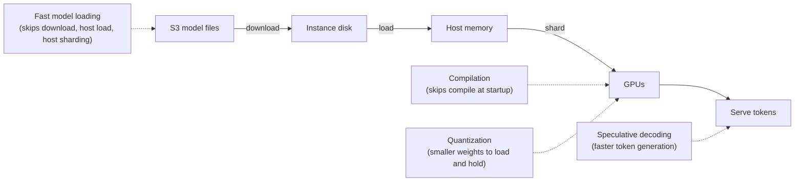

# SageMaker LLM Inference Optimization

Hosting an LLM has problems a normal model doesn't: the weights are huge (tens to hundreds of GB), they must be **split across GPUs**, and every new instance has to load them before it serves anything. SageMaker offers **optimization techniques** (run as an optimization job, using the **Large Model Inference (LMI) container**) that each attack a different slow or expensive step.

**Remember:** first find *which step* is slow or costly, then pick the technique. They are not interchangeable.

## The four techniques

| Technique | What it does | Fixes | Accuracy |
|---|---|---|---|
| **Fast model loading** | **Pre-shards** the model into equal chunks (8 MB in AWS's description) in S3; a new instance **streams weights straight from S3 onto the GPUs**, skipping the disk download, host-memory load and host-side sharding | **Slow startup / slow scale-out** (instances take minutes before serving) | **Unchanged**: it only splits and arranges weights |
| **Compilation** | Compiles the model **ahead of time** for the target hardware (TensorRT-LLM on GPU; Neuron SDK on Trainium/Inferentia), so new instances don't compile just-in-time | Slow startup **when compile time is the slow step**; also faster on that hardware | No loss |
| **Quantization** | Lower-precision weights and activations: **INT4-AWQ**, **FP8**, **INT8-SmoothQuant** (formats vary by model) | **Cost / memory**: fits on smaller, cheaper, more available GPUs | **May drop** |
| **Speculative decoding** | A small, fast **draft model** proposes several tokens; the large **target model** verifies them in parallel and corrects rejects. SageMaker offers a pre-built draft model or you bring your own | **Per-answer latency** (slow generation) | Unchanged quality |

Fast model loading is also what makes **auto scaling** react in minutes instead of tens of minutes. AWS reports up to 15x faster loading, for example a 70B model on `ml.p4d.24xlarge` loading in about a minute (it needs the LMI container and large instances).

## Reading a scenario

| Symptom in the question | Pick |
|---|---|
| Logs show the delay is **copying and loading weights** onto a new instance; once serving it is fast | **Fast model loading** |
| Delay is **compiling** at startup | Compilation |
| Answers are **slow to generate** while in service | Speculative decoding |
| Need to **cut GPU cost / memory** and a small accuracy change is acceptable | Quantization |
| "Approved model must not change or lose accuracy" | Rules out quantization |

## Related pieces

- **LMI container**: AWS's Docker container for LLM serving on SageMaker. It handles **tensor parallelism** (splitting the model across the GPUs of one instance), **continuous batching** and quantization settings; docs are on the DJL site.
- **Inference recommendations**: SageMaker can analyze your model and workload, test instance types and optimizations, and return a validated deployment configuration. This is AWS's recommended route; running individual techniques yourself is the manual route.
- **Pre-optimized models**: many JumpStart models ship in several pre-optimized versions (latency-focused or throughput-focused), so you can deploy one without running a job.
- After optimizing, evaluate latency, throughput and price; for quantization also check quality.

Where this sits in the bigger choice: [Choosing How to Host an FM](../01-GenAI-Fundamentals/Choosing-How-to-Host-an-FM.md), [SageMaker quick reference](00-SageMaker-Quick-Reference.md), [Right-sizing the model](../01-GenAI-Fundamentals/Right-Sizing-the-Model.md).
