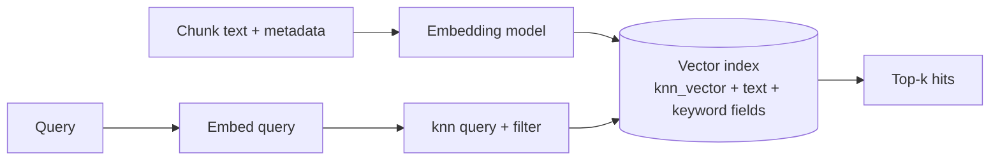

# OpenSearch Serverless Vector Search

A collection type (`VECTORSEARCH`) of Amazon OpenSearch Serverless that stores embeddings and runs k-NN similarity search with no clusters to manage. It keeps vectors, text, and structured metadata together, so one query can combine semantic similarity, keyword matching, and filters.

> **Mental model:** a search engine whose documents carry a vector next to their text and attributes. "Find the nearest vectors *among documents where product = X*" is one query.



**Key Concepts:**
- **Collection**: logical group of indexes; type `VECTORSEARCH` for embeddings.
- **Index**: documents with a common schema; vector field type is `knn_vector`.
- **k-NN**: nearest-neighbour search; approximate (ANN) via HNSW.
- **Access control**: encryption policy, network policy, data access policy (all required); `aoss:*` IAM actions.

---

## Collection Generations

| | NextGen (recommended for new) | Classic |
|---|---|---|
| Scaling | On demand; scales to **zero** when idle | OCU-based auto scaling |
| Default compression | **32x** (options 1x, 2x, 8x, 16x, 32x) | Quantization options (Faiss 16-bit scalar, binary vectors, disk-based) |
| Index build | GPU acceleration by default (`index.knn.remote_index_build.enabled`) | n/a |
| Engine / mode params | **Not needed** (auto) | Engine required/default `nmslib` |
| Search response | Excludes vector from `_source` by default | Includes vector |
| Custom doc ID | Supported | n/a |
| Read-after-write (`refresh_interval`) | **10 s** | **60 s** |
| Limitations | Radial search not supported with 32x compression | No Lucene engine, no IVF/IVFQ, no warmup/stats/model-training APIs, no scripts |
| Scale | n/a | Billions of vectors; more than 200 OCUs needs a Support request |

---

## Index Mapping and Query

```
PUT housing-index-filtered
{ "settings": { "index.knn": true },
  "mappings": { "properties": {
      "vec":   { "type": "knn_vector", "dimension": 1024,
                 "space_type": "l2", "method": { "name": "hnsw" } },
      "title": { "type": "text" },
      "price": { "type": "long" } } } }

GET housing-index-filtered/_search
{ "size": 5,
  "query": { "knn": { "vec": { "vector": [ ... ], "k": 5,
      "filter": { "bool": { "must": [ { "range": { "price": { "lte": 3000 } } } ] } } } } } }
```

| Setting | Detail |
|---|---|
| `index.knn: true` | Required on the index |
| Vector field | `knn_vector` with required `dimension` |
| Max dimensions (Serverless) | **16,000** |
| Distance metrics | Euclidean (`l2`), cosine, dot product |
| Metadata types | Number, Boolean, date, keyword, geopoint, text |
| `size` vs `k` | Set both; otherwise `k` results **per shard/segment** are returned (managed k-NN docs) |

---

## Filtering: Where the Filter Sits Matters

| Filter placement | Behavior | Result |
|---|---|---|
| **Inside** the `knn` query (`filter` clause) | Restricts the candidate set during k-NN search | Returns up to `k` matching results |
| `post_filter` / outside `knn` | Applied **after** the top-k are found | Can return **fewer than `k`** results |

> [!WARNING]
> Post-filtering a selective condition (one product out of thousands) can return near-empty results. Put product / category filters inside the `knn` query.

Engine behavior (OpenSearch Service vector blog; version-dependent, verify for your version):

| Engine | Filtering | Notes |
|---|---|---|
| Lucene-HNSW | Smart filtering (auto picks strategy) | Up to 1,024 dims, best under ~10M vectors |
| Faiss-HNSW | Post-filter per blog; filter clause documented for Serverless | Used by Bedrock Knowledge Bases |
| Faiss-IVF | Needs training | Not on Serverless |
| NMSLIB-HNSW | Post-filter per blog | Classic Serverless default; not supported by Bedrock KB |

---

## Use with Bedrock Knowledge Bases

| Requirement | Value |
|---|---|
| Engine | **faiss** (nmslib not supported, and breaks metadata filtering) |
| Distance metric | Euclidean recommended for float embeddings |
| Text field | String, **filterable = true** (needed for hybrid search) |
| Bedrock metadata field | String, filterable = false |
| Private access | Standard create + VPC endpoint (PrivateLink) for the collection |

> [!WARNING]
> Index `dimension` must equal the embedding model's output size (table: [Store Options](03-KB-Vector-Store-Options.md)); mismatch breaks ingestion.

---

## Neural Search on Serverless

Lets OpenSearch embed text itself instead of your app passing vectors.

| Component | Role |
|---|---|
| Text embedding ingest processor | Embeds text at index time |
| `neural` query | Embeds `query_text` and searches by vector |
| `neural_sparse` query | Sparse (learned lexical) retrieval |
| Remote models | **Only remote models**, via connectors (e.g. to Bedrock); nothing to deploy |

| Detail | Value |
|---|---|
| Latency gotcha | Up to **15 s** delay before new pipelines / vector index are usable |
| Data access policy resources | `index/<collection>/*`, `collection/<collection>`, `model/<collection>/*` (`aoss:CreateMLResources`) |
| Regions | Limited list (includes us-east-1/2, us-west-2, several ap, eu regions) |

---

## OpenSearch Managed vs Serverless (for Bedrock KB)

| | Serverless | Managed domain |
|---|---|---|
| Ops | None | You size the domain |
| Network for KB | Public or VPC endpoint | **Public access only** (VPC domains unsupported) |
| Version | n/a | ≥ 2.13 for k-NN index; ≥ 2.16 for binary vectors |
| Custom metadata filter fields | Filterable | Must be `keyword` (or `text` with `keyword` subfield), or filters fail with "Rewrite first" |
| Ingestion failures | Check capacity | Raise IOPS/throughput |
| Graph memory / shard sizing | n/a | See [Performance Tuning](04-OpenSearch-Performance-Tuning.md) |

---

## Need → Pick

| Need | Pick |
|---|---|
| No infra, spiky/idle workload | NextGen vector collection (scales to zero) |
| Billions of vectors | Classic collection (request OCU increase) |
| Strict filter on product ID | `filter` inside `knn` query + keyword metadata field |
| Lower memory cost | NextGen compression (32x default), or Classic quantization / disk-based |
| Private connectivity | Standard create + VPC endpoint |
