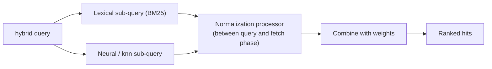

# Hybrid Search and the Precision Pipeline

Keyword (lexical) search is exact but blind to meaning; vector (semantic) search understands meaning but can blur exact identifiers. Hybrid search combines both, and a staged pipeline (filter → retrieve → rerank) pushes the best results to the top for FM context.

> **Mental model:** recall first, precision second. Cast a wide, smart net (lexical + semantic, restricted by filters), then let a sharper judge (reranker) order the catch.

---

## Why Each Method Alone Fails

| Method | Strength | Weakness (support-assistant example) |
|---|---|---|
| Keyword / BM25 | Exact tokens: model numbers, error codes, part IDs | Misses paraphrases ("won't power on" vs "device dead") |
| Vector / semantic | Rephrased and fuzzy questions | General-theme matches outrank specific ones; `X200-B` vs `X200-C` look alike; IDs are weak signals |
| Hybrid | Both signals | Score scales differ; still ranks by a blend, not by deep relevance |
| Hybrid + filter + rerank | Precision on page one | More components to run and tune |

---

## The Precision Pipeline

| Stage | Purpose | Tool | Improves |
|---|---|---|---|
| 1. Filter | Scope to the right product / device / doc type | Metadata filter inside the vector query | Precision (removes wrong-product hits) |
| 2. Retrieve | Find candidates by meaning and exact terms | k-NN + BM25 (hybrid) | Recall |
| 3. Rerank | Re-score candidates against the query | Bedrock reranker model | First-page precision |
| 4. Trim | Send only top few chunks | `numberOfRerankedResults` | Cost, latency, less FM confusion |

---

## Hybrid in OpenSearch

BM25 scores and vector similarity are on different scales, so scores are **normalized** then **combined** in a search pipeline.

| Element | Options |
|---|---|
| Query type | `hybrid` with `queries: [ lexical, neural/knn, ... ]` |
| Normalization technique | `min_max`, `l2` |
| Combination technique | `arithmetic_mean`, `geometric_mean`, `harmonic_mean` |
| Weights | Set per sub-query in the normalization processor |
| Default lexical scoring | Okapi BM25 |
| Available on | OpenSearch Serverless and managed OpenSearch Service (hybrid query since 2.11) |

---

## Hybrid in Bedrock Knowledge Bases

| Item | Detail |
|---|---|
| Control | `retrievalConfiguration.vectorSearchConfiguration.overrideSearchType` = `HYBRID` or `SEMANTIC` |
| Default | Bedrock decides based on the vector store |
| Requirement | Store must have a **filterable text field**; the user guide lists Aurora PostgreSQL (RDS), OpenSearch Serverless, MongoDB Atlas (the API reference mentions OpenSearch Serverless). Aurora index setup: [Store Options](03-KB-Vector-Store-Options.md) |
| Otherwise | Falls back to semantic only |

---

## Need → Pick

| Need | Pick |
|---|---|
| Exact model numbers/error codes must match | Keyword leg (hybrid) + metadata filter on the ID |
| Paraphrased user questions | Vector leg (hybrid) |
| Best ordering on page one | Add a reranker after retrieval |
| Wrong-product answers | Metadata filter inside the query ([why placement matters](01-OpenSearch-Serverless-Vector-Search.md)) |
| Simplest managed setup | Bedrock KB with `HYBRID` on a supporting store + reranker in `Retrieve` |
| Custom score weights | OpenSearch search pipeline (normalization + combination weights) |

**Hybrid score vs Reranking:**

| | Hybrid score | Reranker |
|---|---|---|
| Combines | Lexical + vector scores (normalized, weighted) | Judges each (query, document) pair directly |
| Learns relevance | No (fixed formula + weights) | Yes (trained relevance model) |
| Runs on | Whole index | Shortlist only |
| Fixes | Recall gaps from either method | Order of the shortlist |
| Cost | Query cost | Extra model call per request |
| Alone is enough? | Not for first-page precision | Needs good candidates from retrieval |
