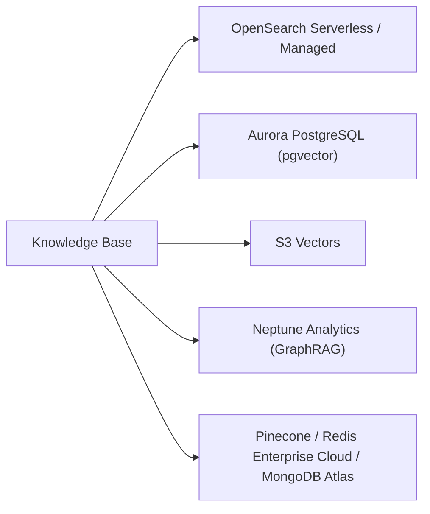

# Vector Store Options for Bedrock Knowledge Bases

Bedrock Knowledge Bases write chunk embeddings to a vector store you choose (or quick-create). Each store has different field mappings, filtering behavior, and limits, and the embedding model's dimension must match the index.

---

## Comparison

| Store | Best for | Hybrid search | Metadata filtering | Binary vectors | Key limits / gotchas |
|---|---|---|---|---|---|
| OpenSearch Serverless | Default choice; hybrid + filters, scale | Yes (needs filterable text field) | Yes (faiss engine) | **Yes** | Engine must be `faiss`; see [OpenSearch note](01-OpenSearch-Serverless-Vector-Search.md) |
| OpenSearch Managed | Existing domain, control over sizing | Yes | Yes | **Yes** | Version/network/field rules: [OpenSearch note](01-OpenSearch-Serverless-Vector-Search.md) |
| Aurora PostgreSQL (pgvector) | Already on Aurora; SQL + vectors together | Yes (GIN on `to_tsvector`) | Yes (JSONB `custom_metadata` + GIN) | No | Same account as KB; fields **fixed after creation**; setup below |
| S3 Vectors | Cheap, large, **infrequent** queries | Semantic only per API note | Yes; no `startsWith`/`stringContains` | No (float only) | Dim 1–4096; ≤ 1 KB metadata and 35 keys/vector with KB; hierarchical chunking can overflow metadata |
| Neptune Analytics (GraphRAG) | Graph-aware retrieval | — | — | — | Vector index only at graph creation; dimensions must match model |
| Pinecone | Existing Pinecone | — | — | — | Creds in Secrets Manager (`apiKey`); third-party terms |
| Redis Enterprise Cloud | Low-latency, existing Redis | — | — | — | TLS required; secret with cert/key fields |
| MongoDB Atlas | Existing Atlas | Yes (user guide) | **Manual** filter config in the vector index | — | Needs secret with `username`/`password`; optional PrivateLink |

> [!NOTE]
> Hybrid support: the user guide lists Aurora (RDS), OpenSearch Serverless and MongoDB; the API reference highlights OpenSearch Serverless. Treat OpenSearch Serverless as the safe answer.

---

## Fields Bedrock Needs in Any Store

| Field | Holds | KB API name |
|---|---|---|
| Vector | Embeddings | `vectorField` |
| Text | Raw chunk text | `textField` |
| Bedrock metadata | Attribution/ingestion metadata | `metadataField` |
| Primary key (Aurora) | Unique id (UUID) | `primaryKeyField` |
| Custom metadata (Aurora, optional) | All metadata-file attributes in JSONB | `customMetadataField` |

---

## Aurora PostgreSQL Setup

| Index | Needed for |
|---|---|
| HNSW on `embedding` (`vector_cosine_ops`) | Vector search (required) |
| GIN on `to_tsvector('simple', chunks)` | Keyword side of hybrid (required); `'english'` can improve English accuracy/latency |
| GIN on `custom_metadata` (JSONB) | Metadata filtering |
| Expression index on a key | Frequent numeric range filters, e.g. `year` |

> [!WARNING]
> Filters apply after the HNSW scan, so selective filters can return fewer results. Enable iterative scans (pgvector ≥ 0.8.0): `hnsw.iterative_scan = 'relaxed_order'`, `hnsw.max_scan_tuples = 20000`; they take effect for **new sessions**.

---

## Embedding Dimensions

| Model | Dimensions |
|---|---|
| Titan Text Embeddings G1 | 1,536 |
| Titan Text Embeddings V2 | 1,024 / 512 / 256 |
| Cohere Embed English, Multilingual | 1,024 |

Store dimension must equal model output. S3 Vectors allows 1–4096; OpenSearch Serverless up to 16,000.

---

## Binary vs Float Embeddings

| | Float32 (default) | Binary |
|---|---|---|
| Memory | Larger | Much smaller |
| Store support | All | **OpenSearch Serverless / Managed only** |
| Distance | Euclidean recommended (`l2`) | `hamming` |

---

## Need → Pick

| Need | Pick |
|---|---|
| Hybrid + metadata filtering + managed | OpenSearch Serverless |
| Lowest storage cost, rare queries | S3 Vectors |
| Relational data and vectors in one DB | Aurora PostgreSQL pgvector |
| Relationships between entities | Neptune Analytics GraphRAG |
| Smallest memory footprint | Binary embeddings on OpenSearch |
| Vector DB already standardized | Pinecone / Redis / MongoDB Atlas connector |
