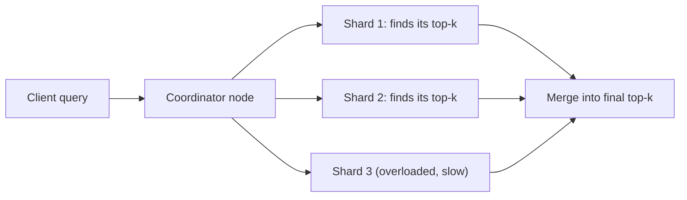

# OpenSearch Vector Search: Performance Tuning

Vector search finds the items whose embeddings are closest to a query's embedding. Comparing the query against tens of millions of vectors one by one is too slow, so OpenSearch uses **approximate nearest neighbor (ANN)** search: it gives up a little accuracy to answer fast. As the data grows, two things can go wrong: searches get **slow**, or the results get **worse** (weakly related items come back). Both usually come from three causes: how the ANN graph is configured, how the data is split across shards, and whether the graphs fit in memory.

This note applies to managed OpenSearch Service domains. OpenSearch Serverless hides most of these settings (see [OpenSearch Serverless note](01-OpenSearch-Serverless-Vector-Search.md)).

---

## Background: shards and the HNSW graph

**Shard.** An index is split into pieces called shards, spread over the cluster's data nodes. A replica is a copy of a shard. When a query arrives, a coordinator node sends it to every shard in parallel, each shard searches its own vectors, and the results are merged. The answer is only as fast as the **slowest shard**, which is why one overloaded shard hurts everyone.

**HNSW (Hierarchical Navigable Small World).** The ANN method used here. Each vector is linked to a handful of nearby vectors, forming a graph. To search, OpenSearch enters the graph at a starting point and keeps hopping to whichever linked vector is closer to the query, until it can't get closer. Upper layers of the graph have long links (big jumps), lower layers have short links (fine steps). Because it follows links instead of checking everything, it is fast, but it can miss the true best match. How often it finds the true best matches is called **recall**.

---

## Tuning the HNSW graph

Three settings control the trade-off between recall, speed, and memory:

| Setting | Set when | What it does | Raising it |
|---|---|---|---|
| `m` | index build | Links per vector | Better recall, **more memory** (about 8 bytes more per vector per extra link) |
| `ef_construction` | index build | Candidates examined when inserting a vector | Better-built graph, **slower indexing** |
| `ef_search` | query time | Candidates kept while walking the graph | Better recall, **slower queries** |

`m` and `ef_construction` shape the graph, so changing them means **rebuilding (reindexing)**. `ef_search` can be changed without a rebuild, so tune it first.

A practical order:
1. Measure recall and latency (p95/p99) at peak traffic.
2. Raise `ef_search` until recall is acceptable; watch latency.
3. If recall is still weak or latency too high, reindex with a different `m` / `ef_construction`.

Guidance from the AWS billion-scale benchmark (tested ranges: `m` 8–64, `ef_construction` and `ef_search` 32–512):
- For accuracy and latency, `m` 32–64 with `ef_construction` and `ef_search` 256–512.
- A balanced setup is `m` 16–32 with both `ef` values 128–256.
- Example at 1 billion vectors: `m=8` gave 9.1 ms p50 latency, 0.84 recall, 1,182 GB memory; `m=64` gave 103.7 ms, 0.99 recall, 2,055 GB. More links bought recall at the price of both speed and memory.

**When memory is the problem instead.** IVF with product quantization (PQ) compresses the vectors so far less memory is needed, at the cost of recall and an extra training step. Numbers from the same 1-billion-vector benchmark:

| | HNSW | IVF + PQ |
|---|---|---|
| Memory | 1,182–2,055 GB | 68–114 GB |
| Benchmark cluster cost | about $75/hour | about $11/hour |
| Recall@10 | 0.84–0.99 | 0.17–0.61 at tested settings |
| Training step | None | Required (`nlist`, `nprobes`) |
| On OpenSearch Serverless | Yes | No |

---

## Memory: graphs must fit in RAM

HNSW graphs are kept in native (off-heap) memory so searches are fast. If they don't all fit, graphs get evicted and reloaded, and latency spikes.

Graph memory per copy of the data is about `1.1 × (4 × dimensions + 8 × m) × number of vectors` bytes. Example with generic numbers: 10 million vectors, 1,024 dimensions, `m=16` → 1.1 × 4,224 × 10M ≈ 46.5 GB. Every replica needs its own copy, so one replica doubles it.

How much a node can use: half of its RAM goes to the Java heap (up to 32 GiB), and k-NN may use up to **50% of the remaining half**. So a node with 32 GiB RAM has about 8 GiB for graphs. Divide total graph memory by that to get the minimum number of data nodes.

> [!WARNING]
> When graph memory reaches the circuit-breaker limit (`KNNGraphMemoryUsagePercentage` at 100%), OpenSearch rejects new `knn_vector` indexing.

---

## Shards: size, count, balance

Good shard sizing keeps each shard small enough to recover and search quickly, and the shards spread evenly across data nodes.

| Guideline | Value |
|---|---|
| Shard size when search latency matters | 10–30 GiB (billion-scale blog used 10–50 GB) |
| OpenSearch Service default | 5 primary shards + 1 replica per primary |
| Shards per GiB of Java heap | No more than 25 |
| Per-node shard cap | 1,000 (up to OpenSearch 2.15); 1,000 per 16 GB heap up to 4,000 (2.17+) |
| Replicas in production | At least 1 |

The **primary shard count is hard to change** later, so decide before indexing the first document; otherwise you reindex. Too many small shards waste CPU and memory.

**Estimating the count:** (data + room to grow) × (1 + indexing overhead) ÷ target shard size. Generic example: 300 GiB including growth × 1.1 ÷ 30 GiB ≈ 11 shards; round to 12 so they divide evenly over 6 data nodes.

**Hot shards.** A hot shard is one that gets far more load than the others (more data, more traffic, or sitting on a busier node). Because a query waits for its slowest shard, a hot shard raises tail latency during traffic spikes even when average latency looks fine. To fix it: find it in OpenSearch Dashboards or per-node metrics, then resize and rebalance (reindex into a better shard count, align the count with the number of data nodes) and add replicas to spread reads.

---

## Watching the system

Use **node-level** metrics and the **Maximum** statistic. Cluster averages hide a single hot node.

| Metric | What it tells you |
|---|---|
| `SearchLatency`, `SearchRate` (per node) | Where searches are slow; a node far above its peers is hot |
| `CPUUtilization` Maximum vs Average | A big gap between them means imbalance |
| `ThreadpoolSearchQueue` (max 1,000), `ThreadpoolSearchRejected` | Search is saturated; growing rejections mean overload |
| `KNNGraphMemoryUsagePercentage` | How close graph memory is to the circuit-breaker limit |
| `KNNEvictionCount`, `KNNMissCount` vs `KNNHitCount` | Graphs are being pushed out of memory and reloaded |
| `KNNCircuitBreakerTriggered`, `KNNCacheCapacityReached` | The memory ceiling has been reached |
| `JVMMemoryPressure` | Java heap health, separate from graph memory |

**Where does API time go?** Trace Analytics shows rate, errors, and duration for your instrumented services, including the call into OpenSearch. It sees your request path, not shard internals.

After each change, re-test under peak-like load and compare p95/p99, not averages.

---

## Fixes that don't work

- **Raising top-K for every query**: each shard does more work, so queries get slower (and `k` tops out at 10,000). A reranker on top adds another step and improves ordering, not index efficiency.
- **Autoscaling on CPU only**: the problems are shard imbalance, graph memory, and ANN settings, none of which CPU alone shows.
- **One big node to avoid cross-shard traffic**: removes horizontal scaling; graphs must still fit in one node's memory.
- **Snapshots**: they are backups; they don't change latency or relevance.
- **"Switching to HNSW" with defaults and the same shards**: HNSW is already the algorithm; the default settings and the imbalance remain.
- **Judging by cluster-average CloudWatch**: hides hot shards and tail latency.

Relevance beyond ANN settings (hybrid scoring, reranking): [Hybrid Search](02-Hybrid-Search.md). Filter placement and engines: [OpenSearch Serverless note](01-OpenSearch-Serverless-Vector-Search.md).
