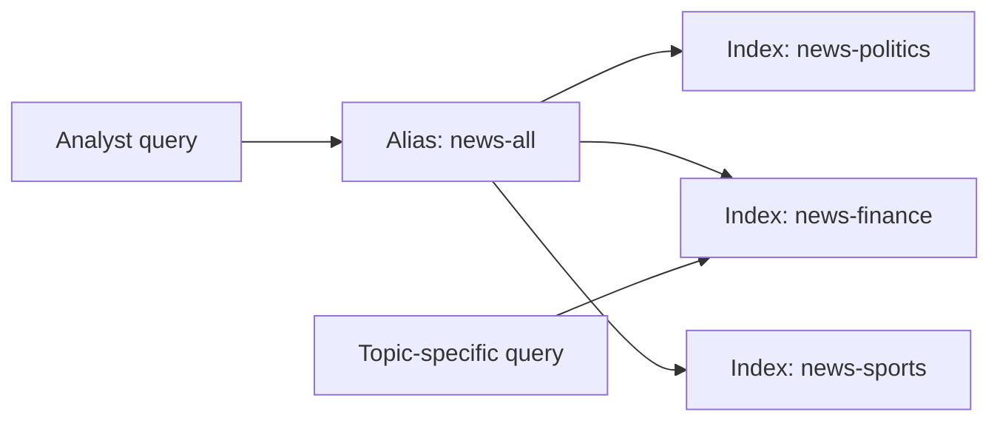
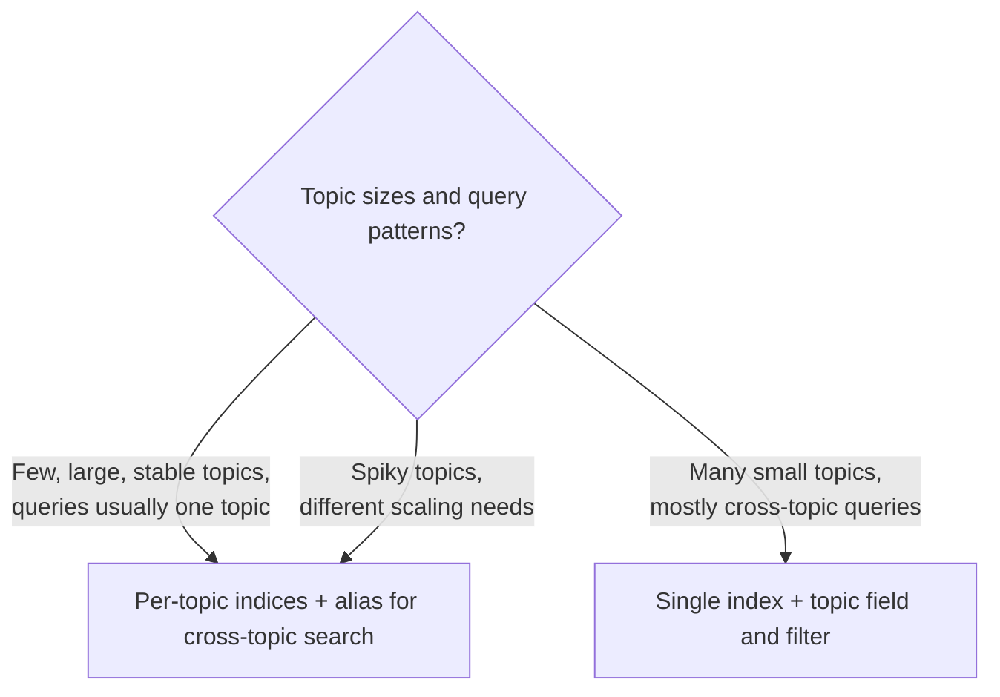

# Designing OpenSearch Indices for Vector Search

Before any data is loaded, a vector search deployment needs three design decisions: **how the search is run** (exact or approximate), **how the data is split into indices** (one big index or one per topic), and **what each index's mapping looks like**. These choices decide how fast queries are, how well the cluster survives a spike, and how painful changes are later.

This note is about those choices. Tuning an existing index (HNSW parameters, shard sizing, memory, hot shards) is in [Performance Tuning](04-OpenSearch-Performance-Tuning.md), and combining keyword and vector scoring is in [Hybrid Search](02-Hybrid-Search.md).

---

## Exact vs approximate k-NN

**Exact k-NN** compares the query vector with *every* vector (brute force) and returns the true nearest ones. It is perfectly accurate but its cost grows with the number of vectors, so it does not scale. In OpenSearch it runs through a scoring script over `knn_vector` fields.

**Approximate k-NN (ANN)** uses a graph index such as HNSW to jump toward the nearest vectors without looking at all of them. It trades a little accuracy for large gains in latency, memory and scalability.

| | Exact (script score) | Approximate (ANN, HNSW) |
|---|---|---|
| Accuracy | Always the true nearest | Very high but can miss some (recall below 1) |
| Latency as data grows | Grows with every vector | Stays low |
| Good for | Small sets, or a small pre-filtered subset | Hundreds of thousands of vectors and up, low latency needed |
| Needs a graph index | No | Yes (uses graph memory) |

For millions of articles, exact search over everything is too slow, which is why an index that scans everything cannot handle query spikes. Use ANN as the default at scale.

**Filters change the picture.** Exact search is a good fit when a filter first shrinks the candidates to a small set. ANN with a filter applied *after* the search (`post_filter`) can return fewer than `k` results, and the scoring-script filter doesn't scale for large filtered sets. Newer versions can filter *during* the ANN search (efficient k-NN filtering), which is the usual choice. Filter placement details: [OpenSearch note](01-OpenSearch-Serverless-Vector-Search.md).

---

## One index or one per topic?

Imagine millions of news articles a day across politics, finance, sports, technology and more. You can put everything in one index and filter by a `topic` field, or give each topic its own index.

**Per-topic indices** give you:
- **Query locality**: a finance question searches only the finance index, touching fewer shards and a smaller graph, so it is faster and cheaper.
- **Independent tuning**: each index can have its own shard count, replica count, and even HNSW settings, sized to that topic's volume and traffic. A topic that spikes during an event can be given more replicas without scaling everything.
- **Independent lifecycle**: retention, reindexing, and rollover per topic.
- **Fault isolation**: a heavy topic doesn't slow the others as much.

**Costs of splitting:**
- Every index adds shards, and every shard uses CPU and memory (keep within shards-per-heap and shard-size guidance in [Performance Tuning](04-OpenSearch-Performance-Tuning.md)). Hundreds of tiny indices can hurt more than help.
- A search across topics must query several indices (use an alias that spans them).
- Topics of very uneven size create uneven indices.

**A single index with a topic filter** is simpler to operate and to search across everything, but every query pays for the whole graph, selective filters on ANN can misbehave, and one set of shard and replica settings must suit all topics.

**Aliases** make this manageable. An alias is a name that points to one or more indices:
- one alias over all topic indices gives one place to search everything,
- a **filtered alias** exposes only a slice of an index,
- swapping an alias from an old index to a rebuilt one is atomic, so you can reindex (for example to change a mapping or shard count) with no downtime.

---

## Mapping design

A vector index usually needs several kinds of field working together, because the search combines meaning, words, and exact attributes.

- **Vector field** (`knn_vector`): the embedding. Its `dimension` must equal the embedding model's output size, and the index needs `index.knn: true`.
- **Text field** (`text`): the article body or chunk, analyzed so full-text (BM25) matching works. This is the keyword side of hybrid search.
- **Keyword fields** (`keyword`): values matched exactly, never analyzed, used for filters, sorting, and aggregations: `topic`, `source`, `language`, `region`. If you also want full-text search on a field, give it a `keyword` sub-field.
- **Date and numeric fields**: publish time, scores, for range filters ("last 24 hours").

Defaults are risky: dynamic mapping can guess a field wrong (a topic mapped as analyzed text can't be filtered exactly), and changing a field's type later means **reindexing**.

**Index templates** apply the same mappings and settings automatically to every new index that matches a pattern (for example `news-*`), so all topic indices stay consistent and a new topic needs no manual setup.

---

## Shards and replicas for spikes

- **Primary shards** split the data so queries and indexing run in parallel; the primary count is hard to change later.
- **Replicas** are full copies of the shards. They give failover and **extra capacity for search**, so adding replicas is the usual way to absorb a read spike.
- A replica duplicates the graph in memory, so each extra replica multiplies memory needs (formula and node budget in [Performance Tuning](04-OpenSearch-Performance-Tuning.md)).

With per-topic indices you can raise replicas only on the topics that surge during a major event.

---

## Neural Search on a managed domain

The Neural Search plugin lets OpenSearch create embeddings itself, so you don't compute them in your application:
- an **ingest pipeline** with a text-embedding processor embeds documents as they are indexed,
- the **`neural` query** embeds the query text and searches the vector field,
- combined with a lexical query inside a **`hybrid`** query, with score normalization, it provides hybrid retrieval.

On managed domains the embedding model can be hosted in the cluster or reached through a connector; on Serverless only remote models are supported. Hybrid scoring: [Hybrid Search](02-Hybrid-Search.md).

---

## Why a tunable OpenSearch design wins here

The requirements are semantic relevance **plus** keyword precision, ANN speed, topic segmentation, and control over mappings, shards and replicas.
- **OpenSearch with Neural Search, topic indices, and ANN** provides all of them and lets you tune each.
- **A Bedrock Knowledge Base with metadata tags** gives managed retrieval, but not control over shard counts, replicas, or mappings.
- **Athena federated queries** are not a vector search engine.
- **One global index with defaults and exact k-NN** scans every vector per query and offers no topic locality or tuning, so it fails under spikes.
