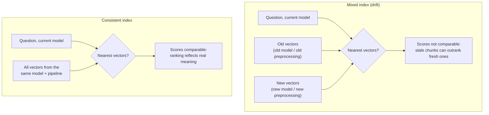
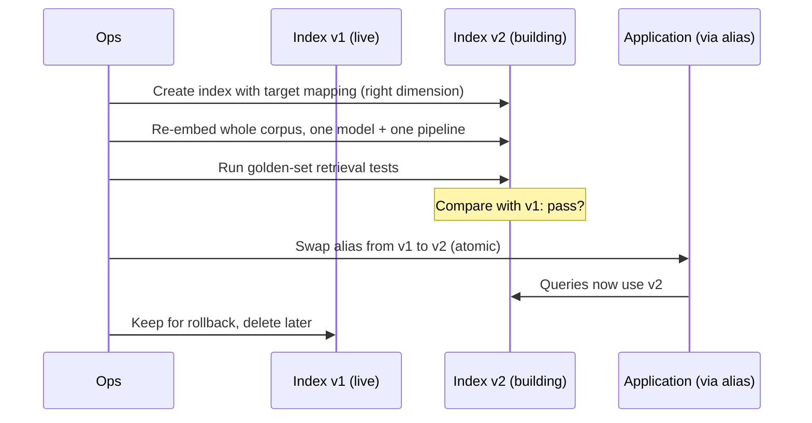

# Embeddings, Embedding Drift, and Keeping an Index Fresh

A RAG assistant is only as current as its vector index. Two different things can make it answer from outdated knowledge, and they need different fixes:

1. **Stale content**: the documents changed but the index wasn't updated, or removed documents are still in it.
2. **Embedding drift**: the index contains vectors made in *different ways* (different embedding model, different preprocessing), so similarity scores can't be trusted.

This note explains both, how to detect them, and how to repair them safely.

---

## What an embedding is, and why mixing breaks things

An embedding model turns text into a list of numbers (a vector). Texts with similar meaning end up close together. Search works by turning the **question** into a vector with the same model and finding the nearest stored vectors.

A good way to picture it: every embedding model draws its **own map**. On a map, "close" only means something if both points are drawn on the *same* map. A coordinate from map A has no meaning on map B, even if the numbers look similar. So a question embedded with the current model is only meaningfully comparable to vectors made by that same model.

**Preprocessing counts too.** The vector depends on the exact text embedded, so a changed chunking strategy, cleaning rule, or parsing method changes the vector even with the same model. "Same model, different chunking" is also a mixed index.

That is why, when the embedding model or preprocessing changes, the only reliable repair is to **re-embed the whole corpus** with one model and one pipeline.

> [!WARNING]
> Things that do *not* fix drift: re-embedding only the changed documents, tuning ANN settings (they change speed and recall, not what the vectors mean), metadata filters, or a reranker. Filters and rerankers refine ranking inside one consistent space; they can't repair vectors that aren't comparable.

---

## Recognising embedding drift

Typical signs: the knowledge base was updated, yet answers still reflect old procedures; quality dropped after a model or pipeline change; results for the same question vary between environments.

**Check the population first.** Record with every vector which embedding model, model version, dimension, and chunking/preprocessing version produced it (as metadata). Counting vectors per version shows immediately whether the index is mixed. If you didn't record this, the dimension at least reveals a model mix, since an index cannot hold different dimensions in one vector field.

**Measure retrieval quality with a golden set.** Keep a fixed list of real questions, each with the document(s) that should be returned. Run them regularly and track:
- how often the correct, up-to-date document appears in the top results,
- how often an obsolete document appears above the current one,
- the rank of the correct document.

Run it before and after any model or pipeline change. A drop on the golden set, or obsolete content ranking high, confirms a problem. Bedrock evaluation tools can score retrieval quality: [Bedrock Evaluations](../02-Amazon-Bedrock/09-Model-Evaluation/01-Bedrock-Model-Evaluation.md).

**Worked example (generic numbers).** A corpus of 1,000 documents: 300 were re-embedded with the new model and 700 still use the old one. A question about the new reset procedure is embedded with the new model. The current document is in the new set, but the obsolete document from the old set can still land nearer, because old and new vectors live in different spaces. Fixing only the 300 changed documents leaves the other 700 unreliable; re-embedding all 1,000 makes scores comparable.

---

## Repairing it without downtime

Don't overwrite the live index in place. Build a clean one beside it and switch.

- The application queries an **alias**, not an index name, so switching is one atomic change and rollback is switching back (alias mechanics: [Index Design](05-OpenSearch-Index-Design.md)).
- The **query side must change too**: queries must be embedded with the *same new model* as the vectors, or the new index is unusable.
- If the new model has a different dimension, the new index needs a matching `dimension` (it can't reuse the old mapping).
- After the swap, keep the golden-set test in a regular schedule to catch regressions.

---

## Keeping a Knowledge Base current (stale content)

Bedrock Knowledge Bases do **not** pick up source changes by themselves. You must **sync** the data source, and syncing is **incremental**:

| What changed in the source | What the sync does |
|---|---|
| Nothing | Skips the document |
| New document | Ingests only that document |
| Content or metadata changed | Re-ingests it (parse, chunk, embed, index again) |
| Document deleted | Removes it from the vector store |

Because deletions are handled, obsolete content disappears on the next sync. If a removed procedure still shows up, the usual cause is that nobody ran the sync.

More things to know:
- **Run the sync** with `StartIngestionJob` (check `GetIngestionJob`; status `COMPLETE` and the `statistics` show how many documents succeeded or failed). Trigger it from events (for example S3 change events) or on a schedule so it isn't manual. A job can be stopped and restarted.
- **Newly synced data can take a few minutes** to be queryable in vector stores other than Aurora.
- **Metadata-only changes** can skip re-embedding: if only `.metadata.json` files change, Bedrock updates the stored vectors' metadata without calling the embedding model (not for CSVs, and not with a custom transformation Lambda).
- **Direct ingestion** (`IngestKnowledgeBaseDocuments`, `DeleteKnowledgeBaseDocuments`) adds, updates, or deletes documents immediately without a full sync, for S3 and custom data sources. For S3 sources, mirror the change in S3 too, or the next sync overwrites it, and don't run direct ingestion and `StartIngestionJob` at the same time.
- **Embedding model and chunking are fixed at creation.** You can't switch a Knowledge Base to another embedding model; create a **new Knowledge Base** with the new model and re-ingest. This is the Bedrock-managed version of the full rebuild above, and it is also why a "single Titan model with uniform preprocessing" answer works: a Knowledge Base *guarantees* one model and one pipeline for everything it ingests.
- **Data deletion policy** (`DELETE` default, or `RETAIN`) decides whether the stored vectors are removed when you delete the data source or Knowledge Base.

For custom pipelines (your own OpenSearch ingestion), you own this: detect changes, re-embed changed items, **delete vectors for removed documents by ID**, and record the model and pipeline version on every vector.

---

## Embedding models on Bedrock

Pick one model and keep it for an index. Reference for the common ones used with Knowledge Bases:

| Model | Vector size | Vector types | Notes |
|---|---|---|---|
| Titan Text Embeddings V2 | 1,024 (default), 512, 256 | float, binary | Optional `normalize` (default true); choose size per request |
| Titan Embeddings G1 - Text | 1,536 | float | No inference parameters |
| Cohere Embed English / Multilingual (v3) | 1,024 | float, binary | Pick Multilingual for mixed languages |
| Titan Multimodal Embeddings G1, Cohere Embed v3 multimodal, Nova Multimodal | 1,024 | float (+ binary for Cohere) | Text plus images/other media |

- **Dimensions are a trade-off.** Fewer dimensions mean smaller storage and faster search at the cost of some accuracy; the vector field's `dimension` must match the choice. Details: [Store Options](03-KB-Vector-Store-Options.md).
- **Binary vectors** are far smaller than float, and are supported only on some vector stores.
- **Titan V2 request** (`InvokeModel`): `inputText` plus optional `dimensions`, `normalize`, `embeddingTypes`; the response returns `embedding`, `inputTextTokenCount`, and `embeddingsByType`.
- **Batch generation.** Titan takes one text per call, so for large corpora run many calls in parallel (for example SQS feeding Lambda), respect throttling quotas, and write results with the model and pipeline version attached.

---

## Why a full, uniform rebuild is the answer

- The problem is a **mixed vector population**, so the cure must make the population uniform.
- A single embedding model and uniform preprocessing remove the mismatch at its source.
- Evaluation after the rebuild (golden-set relevance, drift checks) proves updated content now ranks properly.

The other approaches keep legacy vectors in the index (partial refresh, changed-only re-embedding, ANN tuning, filters plus reranking) and so keep the mismatch.
