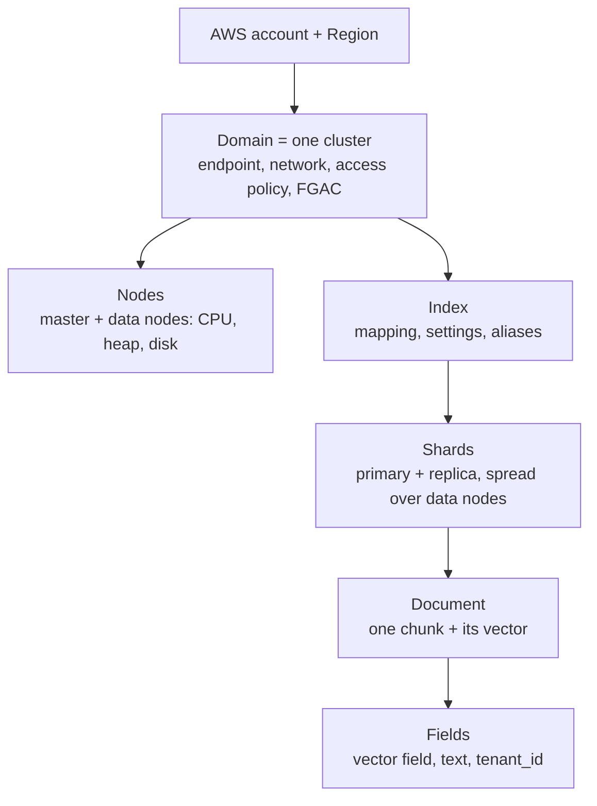
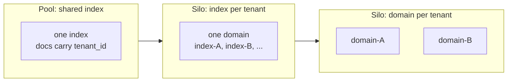

# Multi-Tenant Vector Isolation in OpenSearch

A SaaS RAG app serves many customers (**tenants**) from one platform. The design question is **at which level of OpenSearch's hierarchy a tenant gets its own space**: the higher the level, the stronger the isolation and the higher the cost.

## The OpenSearch hierarchy

- **Domain**: the cluster. Owns the endpoint, the network setting (public or VPC), the **domain access policy**, and **fine-grained access control (FGAC)**. All its indices **share its nodes**.
- **Index**: a named collection of documents with one mapping (such as a k-NN vector field). Split into **shards**, which are placed on the nodes. Many small indices means many shards, and shard counts per node are capped ([sizing](04-OpenSearch-Performance-Tuning.md)).
- **Document**: one stored item, here a chunk plus its embedding. **Field**: one attribute of it; `tenant_id` is just a field.

**OpenSearch Serverless** drops the node layer: **account/Region → collection → index → document**. A **collection** (type *vector search*, fixed at creation) groups indices for one workload and carries its own encryption, network and **data access policies**. Capacity is OCUs (6 GiB memory each) and shards are managed for you. Details: [OpenSearch Serverless](01-OpenSearch-Serverless-Vector-Search.md).

## Where security applies at each level

| Level | Control |
|---|---|
| Network | VPC access vs public endpoint, security groups |
| Domain | **Domain access policy** (IAM resource policy) and IAM identity policies: which principals may call which domain, or even which index path |
| Cluster, index | FGAC roles: cluster permissions, **index permissions** by index pattern |
| Document | FGAC **document-level security (DLS)**: a role carries a query; the user only sees matching documents |
| Field | FGAC **field-level security** (hide fields) and **field masking** (hash the value) |

FGAC needs OpenSearch or Elasticsearch 6.7+, HTTPS, node-to-node encryption and encryption at rest, and **can't be disabled once enabled**. Users are mapped to roles directly or through **backend roles** (for example an IAM role ARN), so you map one role to many users.

## Three tenancy models

| | **Pool** (shared index) | **Silo, index level** | **Silo, domain level** |
|---|---|---|---|
| Isolation enforced by | FGAC **document-level security** on `tenant_id` | IAM or FGAC **index permissions** | Separate domain + IAM resource policy |
| Noisy neighbor | **High**: shared index, nodes, caches | **Moderate**: separate indices, **same nodes** | **None**: own nodes |
| Scale (tenants) | Highest: thousands | Capped by **shard limits** | Limited: domains to patch and monitor |
| Cost | Lowest | Medium | Highest (billed while idle) |
| New tenant | Add a role | Create an index and role | Provision a domain |

**Why index-per-tenant fails at scale:** every index adds shards, a domain only holds so many, and tiny tenants leave most shards idle. **Why it doesn't give performance isolation:** indices still share CPU, JVM heap and disk I/O, so one tenant's heavy vector search slows the rest. Only a separate domain gives separate compute.

## Enforcing and routing

- **Pool with DLS**: add `tenant_id` to every document, create one FGAC role per tenant with a DLS query such as `{"term": {"tenant_id": "tenant-1"}}`, and map the tenant's backend role to it. OpenSearch applies the filter even if the client asks for more. Never rely on the client to add the filter.
- **Silo**: Lambda looks up the tenant's **domain endpoint or index name in a mapping table** (for example DynamoDB) keyed by tenant ID taken from the verified token, then calls that target with credentials limited to it.
- **Identity flow**: API Gateway authorizer or Cognito identifies the tenant; Lambda assumes a **tenant-scoped IAM role** (see [federated access](../09-Security-Governance-Responsible-AI/02-Federated-Access-to-Foundation-Models.md) for the ABAC pattern).
- **Bedrock Knowledge Bases**: tenants in a shared store are usually separated with a `tenant_id` **metadata filter** on each query. That filter is supplied by the caller, so your application layer must set it from the verified identity; it is not enforced by the store the way DLS is.

## Hybrid tiering

Match the model to what each tier needs: **pool for the long tail** of small, cost-sensitive tenants, **domain silo for a few large or regulated tenants** that need guaranteed performance and strict isolation. Choose by the requirement: *cost minimization* points to pool, *noisy-neighbor protection or compliance isolation* points to a dedicated domain.
