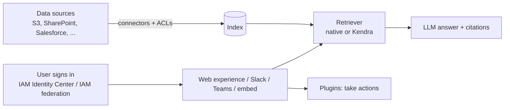

# Amazon Q: The Whole Family

**Amazon Q** is AWS's family of generative-AI assistants (built on Amazon Bedrock). The members are different products for different people, so the first step is knowing which is which.

| Product | For whom | What it does |
|---|---|---|
| **Q Business** | Employees | Answers questions, summarizes and acts on **your company data**, respecting each user's permissions |
| **Q Apps** (inside Q Business, Pro) | Employees | Build and share small AI apps from a prompt |
| **Q Developer** | Developers, IT | Coding help, code upgrades, security scans, AWS guidance |
| **Q in QuickSight** | Analysts | Build dashboards and ask questions of data in natural language |
| **Q in Connect** | Contact-center agents | Detects the customer's issue and suggests real-time answers and actions |

> [!NOTE]
> **Status changes (check current docs):** Q Business is **no longer open to new customers** (AWS points to *Amazon Quick*). The Q Developer chat in the AWS console is now the **AWS assistant**; Q Developer IDE plugins end support on **30 Apr 2027** (AWS points to [Kiro](02-Kiro.md)). Q Developer in the IDE/CLI keeps its name. The concepts below still describe how the products work.

---

## Q Business

A managed **RAG assistant** for enterprise data: ask in plain language, get answers **with citations**, only from content the user is allowed to see.

- **Permissions-aware:** connectors **crawl ACLs** and map identities, so a user's answer only draws on documents they can access. Sign-in uses **IAM Identity Center** or **IAM federation** (SAML/OIDC). **Anonymous applications** are possible for public use.
- **Retriever:** the built-in **native retriever**, or an existing **Amazon Kendra** index ([Kendra](../../14-Machine-Learning-Services/12-Kendra/README.md)).
- **Index types:** **Starter** (1 AZ, proof of concept) vs **Enterprise** (3 AZs, production, supports customer managed keys). Capacity is measured in index units (a unit covers up to 20,000 documents or 200 MB of text). You pay for **user subscriptions + index capacity**.
- **Connectors vs plugins:** connectors **ingest** data on a schedule for search; **plugins** call live apps to **read or act** (Jira, Salesforce, ServiceNow, Zendesk, or **custom plugins** defined with an OpenAPI schema), usually with a confirmation step.
- **Integrations:** web experience, browser extensions, Slack, Microsoft Teams and Office, an embeddable chat, and **data accessors** to share your index securely with verified ISVs.

| | Lite | Pro |
|---|---|---|
| Q&A on enterprise data with citations, file upload, SSO | Yes | Yes |
| Answers from the LLM's general knowledge, content generation | No | Yes |
| Plugins (built-in and custom), chat orchestration | No | Yes |
| **Q Apps**, Slack/Teams integrations | No | Yes |

**Admin controls (guardrails)**
- **Response source:** enterprise data only, or allow fallback to LLM knowledge; optionally let users toggle LLM-only answers.
- **Blocked phrases:** up to **20**, with a custom message. **Topic controls** take precedence over global controls.
- **Hallucination mitigation:** checks RAG answers and corrects them (adds latency; not available with chat orchestration enabled).
- **Chat orchestration:** auto-routes a request across data and plugins. **File upload** and **Q Apps** can be switched on or off.

---

## Q Developer

AI assistant for building and operating software, in the **IDE** (VS Code, JetBrains, Visual Studio, Eclipse), the **command line**, and chat apps (Slack/Teams).

- **Code:** inline completions, chat, new-code generation, debugging, optimizations.
- **Agents:** feature development (`/dev`), tests (`/test`), review (`/review`), docs (`/doc`), and **code transformation** such as language/runtime upgrades.
- **Security:** scan code for vulnerabilities and suggest fixes.
- **AWS help:** questions about architecture, best practices, your resources and costs (now via the AWS assistant in the console).
- **Customization:** tune suggestions on your private code; **reference tracking** flags suggestions resembling open-source code and shows the license.
- **Tiers:** **Free** (sign in with an AWS Builder ID, no AWS account) and **Pro** (subscription, higher limits, admin controls).

---

## Q Business vs building your own RAG

| | Q Business | Bedrock Knowledge Bases + your app |
|---|---|---|
| Effort | Managed app, UI and connectors included | You build the app and choose models and vector store |
| Permissions | Built-in ACL-aware answers | You implement per-user filtering |
| Control | Admin settings only | Full control (chunking, reranking, prompts) |
| Pick when | Quick internal assistant over enterprise content | Custom product experience or special retrieval logic |

See [Knowledge Bases](../02-Amazon-Bedrock/02-Knowledge-Bases/README.md) for the build-it-yourself path.
