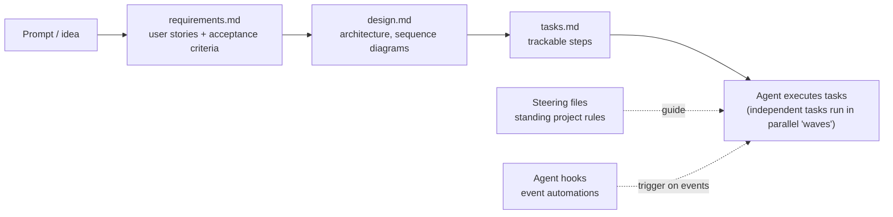

# Kiro

**Kiro** is AWS's **agentic development environment**: an AI IDE (also CLI, web and mobile) where an agent plans and writes software. AWS points Amazon Q Developer IDE users to it (the Q Developer IDE plugins end support on 30 Apr 2027; see [Amazon Q](01-Amazon-Q-Overview.md)).

**Remember:** Kiro's idea is **structure before code**. You give the agent a plan (specs), standing rules (steering), and automations (hooks), instead of re-explaining everything in each chat.

## Core terms

| Term | What it is | Where it lives |
|---|---|---|
| **Spec** | Structured plan for a feature or bug, built in three phases: requirements → design → tasks. Feature specs can be requirements-first or design-first; **bugfix specs** diagnose root cause and prevent regression | `.kiro/specs/` |
| **requirements.md / design.md / tasks.md** | The three spec files: what to build (user stories, acceptance criteria), how (architecture, diagrams), and the step-by-step tasks | in the spec folder |
| **Steering file** | Markdown with **persistent project knowledge and rules** (conventions, libraries, structure) loaded into the agent's context | Workspace `.kiro/steering/`; global `~/.kiro/steering/` (workspace wins) |
| **Agent hook** | An **automation that fires on an event**: run a shell command or inject an agent prompt | `.kiro/hooks/<id>.json` (global `~/.kiro/hooks/` in the CLI) |
| **MCP** | Model Context Protocol: connects the agent to external tools and APIs | configured in Kiro |
| **Powers** | Tool bundles with built-in knowledge that activate on demand | |
| **Custom agents / sub-agents** | Specialized agents for a workflow; sub-agents take parallel delegated tasks | |
| **Permissions and `.kiroignore`** | Control what the agent may touch; keep secrets and sensitive files away from it | project config |
| **Checkpoints / rewind** | Undo changes or fork a conversation | |
| **Compaction** | Summarizes long sessions so they stay within the context limit | |
| **Headless mode** | Run Kiro non-interactively, for CI | CLI |

## Steering files in detail

- **Foundation files** (created by default): `product.md` (purpose, users, goals), `tech.md` (frameworks, tools, constraints), `structure.md` (layout, naming, patterns).
- **Inclusion modes** (set in YAML front matter): **Always** (default, every interaction), **Conditional / `fileMatch`** (only for matching files, such as `components/**/*.tsx`), **Manual** (pull in with `#name` in chat), **Auto** (loaded when the agent judges it relevant).
- **`AGENTS.md`** files are also recognized, including in subdirectories.
- Use steering for rules that should apply every time ("use our logging library", "tests live in `tests/`"), so each prompt stays short.

## Agent hooks in detail

- **Triggers:** file saved, created, or deleted; **PreToolUse / PostToolUse** (gate or validate a tool call); **Stop** (session end); or manual.
- **Defined** by describing it in plain language ("run tests after every file save") or writing the JSON: trigger, optional matcher (file pattern or tool), and action (shell command or agent prompt).
- **Examples:** generate tests for new source files, lint after the agent saves TypeScript, update docs when code changes, block a dangerous tool call.
- Available in the IDE and CLI; limited or none on web and mobile.

## Specs vs chat

- **Vibe / chat mode:** iterate freely with no up-front plan; good for small or exploratory changes.
- **Spec mode:** use for larger or well-defined features where you want reviewable requirements, design, and traceable tasks (a Quick Spec skips approval gates for well-understood features).

## Kiro vs Q Developer

| | Q Developer (IDE/CLI) | Kiro |
|---|---|---|
| Style | Assistant: completions, chat, `/dev`-style agents | Agentic IDE built around specs, steering, hooks |
| Status | IDE plugins end support 30 Apr 2027 | AWS's recommended successor for agentic coding |
