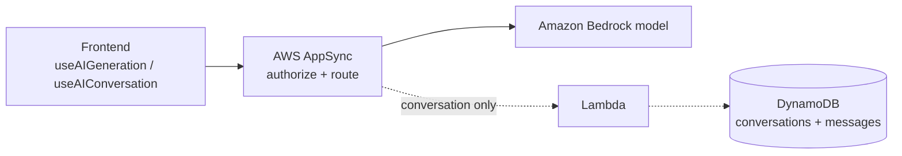

# AWS Amplify AI Kit

Amplify is the full-stack framework for web/mobile apps (hosting and CI/CD basics: [Amplify in the CI/CD note](../../11-AWS-CICD/README.md)). The **Amplify AI kit** adds **AI routes**: backend endpoints, defined in the Amplify **data schema**, that call Amazon Bedrock models. You write **no backend function code**; Amplify wires up the cloud resources and you call the route from the frontend with hooks and UI components.

**Remember:** pick the route by the interaction. **One request → one structured answer** = **generation route**. **Multi-turn chat that remembers** = **conversation route**.



## The two route types

| | Generation route | Conversation route |
|---|---|---|
| **Defined with** | `a.generation()` | `a.conversation()` |
| **Behavior** | Synchronous request and response (an AppSync **query**) | Asynchronous multi-turn chat with **streaming** replies |
| **State** | None: no history, nothing stored | Conversations and messages **stored in DynamoDB** per user |
| **Frontend** | `useAIGeneration` hook or `client.generations.<route>()` | `useAIConversation` hook and the ready-made `AIConversation` chat component |
| **Output** | **Structured data** (a custom type) or a scalar like a string | Chat text |
| **Use for** | Extract fields from text, summarize, classify, one-shot generation | Assistants and help panels that need earlier turns |

Both routes name an **AI model**, a **system prompt**, and inference settings (for example `temperature`, `maxTokens`, `topP`), and are protected by **authorization rules** (for example `allow.authenticated()`).

## Generation route: structured output

```
// in the data schema
createOrder: a.generation({
    aiModel: a.ai.model('<model>'),
    systemPrompt: 'Turn the note into an order.',
  })
  .arguments({ note: a.string() })
  .returns(a.customType({ quantity: a.integer(), deliveryDate: a.date() }))
  .authorization((allow) => allow.authenticated())
```

- The **return type is the contract**: with a custom type the browser gets typed fields back, so **no free-text JSON parsing**. With `a.string()` the model's reply is text again and parsing can fail when the model adds extra words.
- Return types can be custom types or scalars, but **not references to data models**; some scalars (email, date, time, phone, URL, IP address) can't be required fields in the response.
- Call it from a button: `const [{ data }, run] = useAIGeneration('createOrder')`, then `run({ note })`.

## Conversation route

- Amplify stores the conversation and its messages (scoped to the signed-in user), streams replies, and manages history for you.
- **Tools** (`a.tool`) let the model act: query or mutate your data, or invoke a Lambda function, so the assistant can fetch current information or take actions.
- Because it persists messages, it's the wrong choice when the app **must not store** user text.

## What it is built on

**AppSync** authorizes and routes requests, **Bedrock** runs the model, **Lambda** and **DynamoDB** support conversation routes. See [AppSync](../../06-AWS-Compute-Services/14-AppSync/README.md) for the API layer.

## Quick picks

- Button turns a note into typed fields, one click = one request, nothing stored → **generation route with a custom return type**.
- Chat assistant that remembers earlier turns → **conversation route** with the `AIConversation` component.
- Need to show model text as-is (a short description) → generation route with a string return.
