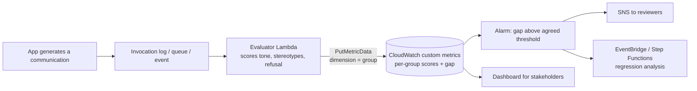

# Fairness and Bias Monitoring for Generated Text

A generative model can treat people differently without anyone intending it: the same request might get a warmer tone, a more detailed answer, or a more stereotyped example depending on the language, name, region, or demographic group implied. For a public-sector agency drafting citizen communications, that is both a harm and a compliance risk. Fairness monitoring turns "we should be fair" into **numbers per group, a threshold everyone agreed on, and an alarm when it's crossed**.

---

## What bias looks like in generated text

- **Tone and style differences**: formal and respectful for one group, curt or condescending for another.
- **Content differences**: fewer details, options, or resources offered to some groups.
- **Stereotyped examples**: the "typical" person in an example always matches a stereotype.
- **Unequal refusals**: the model declines or hedges more for some groups.
- **Quality gaps across languages**: translations or drafts that are less accurate in some languages.

Notice that none of these is "harmful content" in the sense a content filter detects. A polite, non-toxic letter can still be unfair. This is why filtering and fairness measurement are different jobs.

---

## Measuring fairness

The standard approach is **paired (counterfactual) testing**: send requests that are identical except for the group attribute (a name, language, or described demographic), score every response with the same metric, and compare the scores **between groups**. The fairness signal is the *difference* (gap) or ratio between groups, not the overall average, which can look healthy while one group is treated worse.

Examples of metrics you can score per response:
- sentiment or tone score, and the gap between groups,
- a stereotype score (is a stereotype present),
- refusal rate difference,
- completeness or detail difference, and quality difference per language.

How to score a response:
- **An LLM judge**: Bedrock's built-in **Stereotyping**, **Harmfulness**, **Refusal**, and **Professional style and tone** metrics, or a **custom metric** you define for your policy. See [Bedrock Evaluations](../02-Amazon-Bedrock/09-Model-Evaluation/01-Bedrock-Model-Evaluation.md).
- **A text-analysis service** such as Amazon Comprehend sentiment, for simple tone indicators.
- **Your own rules** in code, for example checking whether required resources are mentioned.
- **Human reviewers**, to calibrate whichever automatic scorer you use.

---

## Two moments to measure: before release and continuously

**Offline evaluation** runs before you adopt a model or change a prompt, on a curated dataset. Bedrock evaluation jobs (judge, programmatic, human) and SageMaker Clarify foundation-model evaluation (including the `fmeval` library, which also works for models outside AWS) belong here. It answers "is this safe to ship?".

**Continuous evaluation** runs on real production traffic. Outputs keep changing as prompts, inputs, and models change, so a model that was fair at launch can drift. This is what the question asks for.

---

## The continuous pipeline

Why each part is there:
- **Evaluator Lambda**: computes the fairness metrics for each output (or a sample) the same way every time. It runs asynchronously so citizens never wait for the evaluation. It can call a judge model, Comprehend, or your own rules.
- **Custom CloudWatch metrics**: store the scores as time series with the demographic group as a **dimension**, plus a separate **gap** metric (largest minus smallest group score). Mechanics: [CloudWatch Custom Metrics and Alarms](../10-Observability-and-Cost-Optimization/01-CloudWatch-Custom-Metrics-and-Alarms.md).
- **Alarm** on the gap metric with an "M out of N" evaluation, so one noisy datapoint doesn't page anyone, and a **dashboard** so policy stakeholders can see trends per group.
- **Automated follow-up**: the alarm triggers notification and a workflow that gathers the offending outputs, compares against the last good prompt or model version, and routes to human review. That is how a regression is *analysed*, not just detected.

Design points that decide whether the numbers mean anything:
- Agree the **thresholds** with stakeholders up front; the alarm just enforces them.
- Keep **group dimension values** a small, fixed set.
- Have **enough samples per group per period**; tiny samples produce noise.
- Re-run the same evaluation whenever the **prompt, model, or Guardrails config** changes, so you can attribute a regression to a change.

---

## Why the other designs miss the requirement

- **Guardrails block counts**: Guardrails stops restricted or harmful content. A count of blocked messages is not a measure of whether groups are treated differently, and an unfair but polite letter is never blocked. See [Guardrails policy types](../02-Amazon-Bedrock/04-Guardrails/01-Policy-Types.md).
- **One aggregated sentiment trend**: averaging over everyone hides exactly the difference between groups that you need to see.
- **Sampling plus manual review with a log-volume alarm**: log volume says nothing about bias, and manual inspection is neither measurable nor automatic. Human review is valuable for calibration and for investigating an alarm, not as the detector.

---

## What each AWS tool is for

| Tool | Strength | Best used for |
|---|---|---|
| Bedrock Evaluations (judge, programmatic, human) | Built-in stereotyping, harmfulness, refusal, tone metrics; compare models | Offline gates before release |
| SageMaker Clarify / `fmeval` | Foundation-model quality and responsibility metrics, including non-AWS models | Offline evaluation with more control |
| Evaluator Lambda + CloudWatch | Per-group metrics on live traffic with alarms | Continuous monitoring and regression alerts |
| Bedrock Guardrails | Blocks harmful or restricted content | Safety enforcement, not fairness measurement |

---

## Documenting it: SageMaker Model Cards

A model card is a governance record of a model: intended uses (and uses it should *not* have), a **risk rating** (unknown, low, medium, high), training and evaluation details, and ethical considerations and caveats. Evaluation results can be attached as JSON (for example reports from Clarify or Model Monitor). Edits create new immutable versions (only an approval-status change doesn't), and a card can be exported to PDF for stakeholders. For a regulated agency, the fairness metrics, thresholds, and results of each evaluation belong on the card so audits can trace what was checked and when.
