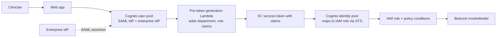

# Federated, Least-Privilege Access to Foundation Models

**Problem:** staff already sign in through an enterprise identity provider (IdP). You need to let them call foundation models with permissions that depend on **who they are** (department, role) and **the request context** (time, network), decided centrally, without moving users or rewriting login.

**Remember:** *Cognito (SAML) federates → pre token generation Lambda adds attributes → IAM policy conditions decide.* Identity comes from the IdP, attributes from the trigger, authorization from IAM.

Already in the repo: [STS federation](../../04-AWS-Identity-and-Access-Management/09-STS/README.md), [Cognito user vs identity pools](../../10-AWS-Monitoring-and-Management/13-Cognito/README.md), [IAM policies and conditions](../../04-AWS-Identity-and-Access-Management/02-IAM-Policies/README.md), [SCPs](../../04-AWS-Identity-and-Access-Management/07-AWS-Organizations/README.md).

## The pieces

- **SAML federation in a user pool.** The enterprise IdP is added to the user pool as a SAML 2.0 provider (you give the IdP the SP entity ID `urn:amazon:cognito:sp:<poolId>` and the ACS URL `https://<domain>/saml2/idpresponse`). Users keep their existing identities; Cognito converts the SAML assertion into standard JWTs. No migration of users. Map `NameId` from an attribute that never changes (not email).
- **Pre token generation Lambda trigger.** Runs just before tokens are issued and can **add, override, or suppress claims**, and change group membership and the IAM roles a user may request from an identity pool. Add `department`, `role` here from a trusted source.
  - `V1_0`: ID token (and group overrides).
  - `V2_0` / `V3_0`: also the **access token** (scopes and claims); need the Essentials or Plus plan (V3 adds machine-to-machine).
  - Not changeable: `sub`, `cognito:username`, and most registered claims.
- **Credentials.** An **identity pool** exchanges the token for temporary AWS credentials (STS) for an IAM role chosen from the claims/groups. Claims can also become principal tags for attribute-based access (identity pool attribute mapping; not verified here).
- **IAM policy with conditions** is the central authorization:
  - `aws:SourceIp` with `IpAddress`: allowed networks. It is **absent on VPC-endpoint requests**; use `aws:SourceVpce` / `aws:SourceVpc` there.
  - `aws:CurrentTime` with `DateGreaterThan` / `DateLessThan`: time-of-day windows.
  - `aws:PrincipalTag/department`: **ABAC**, one policy for all departments instead of one per team.
  - Add `aws:ViaAWSService` exclusions in Deny statements so AWS service-to-service calls aren't blocked.
  - Scope to `bedrock:InvokeModel` and `bedrock:InvokeModelWithResponseStream` (Converse uses the same permissions) on specific model or inference-profile ARNs.
- **Add Guardrails enforcement** with the `bedrock:GuardrailIdentifier` condition key so every call must use the approved guardrail: [Guardrails governance](../02-Amazon-Bedrock/04-Guardrails/03-Tiers-Versions-Governance.md).
