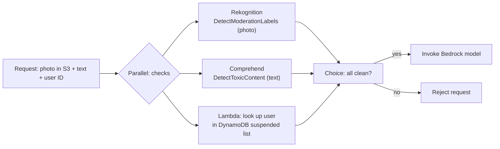

# Input Moderation Workflow with Step Functions

**Problem:** harmful photos, abusive text, and suspended users must **never reach the model**, and the security team wants a record of every check without setting up logging.

**Remember:** *run all checks first (Parallel), gate on the result (Choice), only then call the model.* Use a **Standard** workflow because it keeps the execution history for you.

## Why each piece

- **Parallel state:** runs the three independent checks at once; each branch gets its own copy of the input, so total time is the slowest check, not the sum.
- **Rekognition `DetectModerationLabels`:** reads the photo from S3 and returns moderation labels with confidence; use `MinConfidence` to set the cut-off. ([Rekognition](../../14-Machine-Learning-Services/02-Rekognition/README.md))
- **Comprehend `DetectToxicContent`:** scores the text per category and overall toxicity; English only, up to 10 strings of 1 KB. ([Comprehend](../../14-Machine-Learning-Services/03-Comprehend/README.md))
- **Lambda + DynamoDB:** the suspended-account lookup is your own data, so it needs your own code. Guardrails can't do it: they judge content, not identity.
- **Choice state:** the gate. The model call is a **later state**, never inside the Parallel state, otherwise the model reads the input before the checks finish and the "never reaches the model" rule is broken.
- **Fail closed:** treat a failed or timed-out check as "not clean" (use `Retry` and `Catch`, route errors to Reject).

## Standard vs Express here

The audit requirement decides it. A **Standard** workflow keeps each execution's history (input and output of every state, viewable in the console and via API for 90 days) with no setup. An **Express** workflow keeps no history; you would have to enable CloudWatch Logs. Express fits high-volume short events, not "Step Functions keeps every check by itself". Full comparison: [Step Functions](../../06-AWS-Compute-Services/13-Step-Functions/README.md).

## Guardrails: complement, not replacement

An `ApplyGuardrail` call on the text (and images) is a good extra layer for content filtering, and it keeps policy central ([Using Guardrails](../02-Amazon-Bedrock/04-Guardrails/02-Using-Guardrails.md)). It still can't know who sent the request, so the account check stays in your workflow. Defense in depth is checks before the model plus a guardrail on the model call itself.
