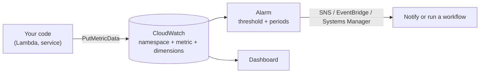

# CloudWatch Custom Metrics and Alarms for GenAI

AWS services publish their own CloudWatch metrics (latency, errors, invocation counts). But the things that matter most for a GenAI app, such as quality scores, hallucination rate, fairness gaps, or cost per request, are not known to AWS. You compute them yourself and **publish them as custom metrics**, then put alarms on them so a regression pages someone instead of waiting to be noticed.

CloudWatch does not pull your metrics. Your code pushes data points; to stop, you stop pushing.

---

## Publishing metrics

A metric is identified by a **namespace**, a **name**, and **dimensions**.
- **Namespace**: a container you choose (for example `GenAI/Fairness`).
- **Dimensions**: name/value pairs that slice the metric, such as `Language=es` or `ModelId=…`. A metric can have up to **30** dimensions. Each distinct combination is its own time series, so use dimensions with a small, known set of values.
- **First publish creates the metric.** There's no separate "create metric" step.
- **Resolution**: standard is one-minute granularity; **high resolution** is one second (and allows 1, 5, 10, 30 second periods). Every `PutMetricData` call on a custom metric is charged, so frequent high-resolution publishing costs more.
- **Statistic sets**: if you have many points per minute, pre-aggregate (sum, min, max, sample count) and publish once instead of many calls. Percentiles need raw data points, so a statistic set loses percentiles unless its sample count is 1 or min equals max.
- **Publishing zero** instead of nothing when there is no data lets an alarm detect a silent pipeline (and keeps averages honest).
- **Delay**: a new metric can be queried within about 2 minutes but may take up to 15 minutes to show in the metrics list.
- For new implementations, AWS recommends publishing custom metrics with OpenTelemetry.

---

## Alarms

An alarm watches one metric (or a math expression over metrics) and changes state when it crosses a threshold. It acts only on **state changes**.

**States:** `OK`, `ALARM`, `INSUFFICIENT_DATA`. You choose how missing data is treated, which matters for sporadic custom metrics.

**Evaluation:** a *period* (length of each data bucket) combined with *evaluation periods* and *datapoints to alarm* ("M out of N") so one noisy point doesn't fire the alarm. The evaluation window can't exceed 7 days (for periods of an hour or more) or 1 day (shorter periods).

**Alarm kinds**
- **Metric alarm**: a metric or metric-math expression versus a threshold. Can notify through SNS, or create investigations, Systems Manager OpsItems or incidents.
- **Composite alarm**: combines other alarms with a rule (for example ALARM only when two conditions hold). Cuts noise; can notify and open incidents, but can't run EC2 or Auto Scaling actions.
- **Log alarm**: evaluates a CloudWatch Logs Insights query on a schedule, to find patterns in logs without building a metric filter.
- **Anomaly detection**: alarms against an expected band learned from history rather than a fixed number, useful for metrics with daily or weekly rhythm (token bursts, traffic).

Useful details:
- You can create an alarm on a custom metric before it exists, but the definition must include **all** the metric's dimensions.
- Test an alarm without waiting using `SetAlarmState` (temporary until the next evaluation).
- Alarm history is kept 30 days.
- Alarms can sit on dashboards, so stakeholders see state at a glance.
- CloudWatch doesn't validate your alarm actions; a missing SNS topic fails silently.

---

## Designing GenAI metrics

- Publish the number you will alarm on. If the concern is a gap between groups, publish the **gap** as its own metric rather than hoping to subtract two alarms.
- Keep dimension values low-cardinality (a handful of languages or groups, a model ID), never per-user or per-request IDs.
- Publish enough samples per period to be meaningful: a fairness score from 3 outputs is noise. Use a longer period or "M out of N" evaluation.
- Do the scoring **outside the user's request path** (asynchronously from logs or a queue) so evaluation never slows or breaks the answer.
- Alarm on regressions against a baseline (agreed threshold or anomaly band), and send them somewhere that triggers action, not just an inbox.

A full worked pattern: [Fairness and Bias Monitoring](../09-Security-Governance-Responsible-AI/01-Fairness-and-Bias-Monitoring.md).
